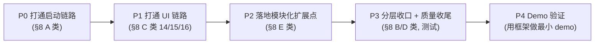
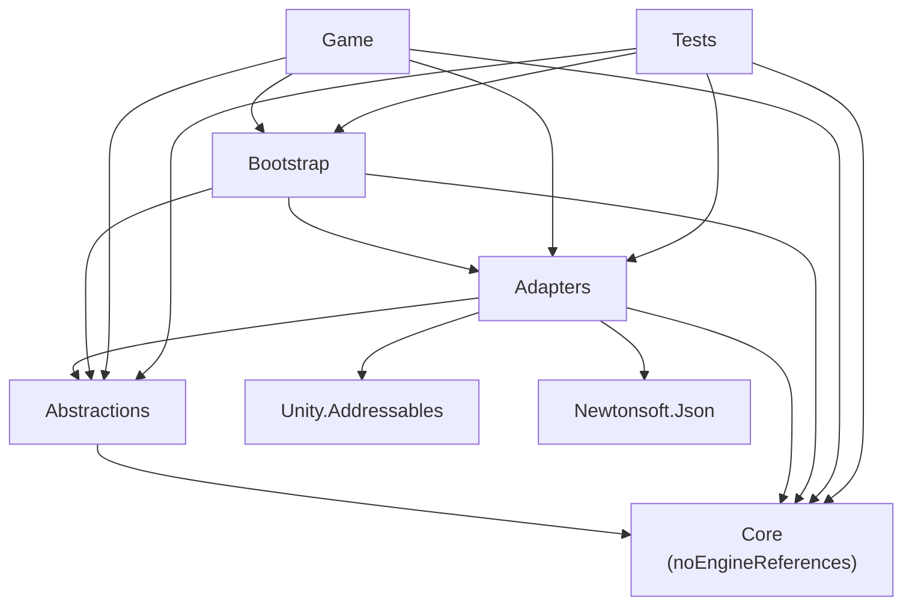
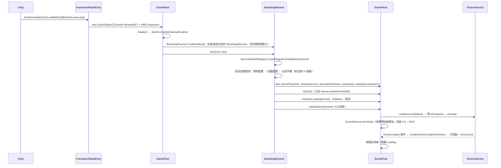

# MyFramework 项目文档 · 工作导航

> 生成时间：2026-10-11　｜　依据：当前工作区代码 + 资源 + ProjectSettings 快照
> 用途：作为后续开发/重构/排障的**唯一依据与导航索引**。修改代码前请先读第 2 节（分层约束）与第 8 节（已知问题）。

---

## 0. 快速索引（我要改某功能，该去哪？）

| 我想做的事 | 去哪里改 |
|---|---|
| 启动流程 / 装配（框架通用） | `Assets/Scripts/Framework/Bootstrap/BootstrapRunner.cs`（含 `FrameworkStartEntry` / `BootstrapOptions` / `LoadStepCollector`） |
| **加载步骤（启动 / 场景预加载）** | `Assets/Scripts/Framework/Abstractions/Loading/**`；业务实现 `IStartupLoadStepProvider` / `ISceneLoadStepProvider` |
| **引导参数（入口/Loading 场景名）** | 实现 `IBootstrapOptionsProvider`；示例 `Assets/Scripts/Game/Bootstrap/GameBootstrapOptions.cs` |
| **5 分钟接入指南（新工程从零接入）** | **根目录 `README.md`** |
| 服务模块扫描与注册 | `Assets/Scripts/Framework/Bootstrap/Modules/ServiceModuleRegistry.cs` |
| **新增配置（零改动）** | 实现 `IConfigFactory` 放 `Game` 程序集（框架自动发现）；示例 `Assets/Scripts/Game/Config/DemoTuningConfig.cs` |
| 配置自动发现逻辑 | `Assets/Scripts/Framework/Bootstrap/GameConfigRegistry.cs` |
| UI 缩放（分辨率/匹配模式） | `Assets/Scripts/Framework/Abstractions/UI/UISettings.cs`（业务在 `MyBootstrapRunner` 用 UI 配置写入） |
| 模块契约（扩展点） | `Assets/Scripts/Framework/Abstractions/Modules/IServiceModule.cs` |
| 框架内置服务（新增/替换实现） | `Assets/Scripts/Framework/Adapters/Modules/CoreServiceModule.cs` |
| 业务扩展模块（示例） | `Assets/Scripts/Game/Modules/DemoGlobalModule.cs` |
| 单元测试 | `Assets/Scripts/Tests/ServiceCollectionTests.cs` |
| 框架启动入口（自动建 GameRoot） | `Assets/Scripts/Game/FrameworkStartEntry.cs` |
| 场景切换 / Loading 流程 | `Assets/Scripts/Framework/Bootstrap/SceneFlow.cs` |
| 场景钩子（加载中做什么） | `Assets/Scripts/Framework/Bootstrap/MySceneFlowHook.cs` |
| DI 容器本体 | `Assets/Scripts/Framework/Core/ServiceCollection.cs` |
| 服务接口定义 | `Assets/Scripts/Framework/Abstractions/**` |
| 服务具体实现 | `Assets/Scripts/Framework/Adapters/**` |
| UI 管理 / 面板工厂 | `Assets/Scripts/Framework/Adapters/UI/UIService.cs`、`PanelFactory.cs` |
| UI 面板基类 | `Assets/Scripts/Framework/Adapters/UI/UIPanelBase.cs` |
| UI 配置资产 | `Assets/Scripts/Game/UI/Config/UIConfigAsset.asset` |
| 业务面板 | `Assets/Scripts/Game/UI/` |
| 资源地址表 | Addressables 面板 → `Default Local Group` |

---

## 1. 项目概览

- **定位**：自研 Unity 通用游戏框架（代号曾用 "Strata"）。核心是「DI 容器 + 程序集分层 + 模块化服务 + 场景流 + 资源/配置/存储/事件/UI 抽象」。
- **引擎**：Unity **2022.3.62f2c1c1**（LTS），URP。
- **关键包**：Addressables `1.22.3`、Input System `1.14.2`、TMP `3.0.7`、Newtonsoft Json `3.2.2`、Cinemachine `2.10.7`、ProBuilder `5.2.4`、Test Framework `1.1.33`、`com.coplaydev.unity-mcp`（编辑器自动化，非运行时依赖）。
- **状态**：**M1 最小可运行 + M2 UI 链路 均已达成**（2026-10-11）：启动链路端到端跑通，UI 从配置→注册→异步加载→打开/关闭/缓存全链路可用。

### 顶层目录

| 目录 | 说明 |
|---|---|
| `Assets/Scripts/` | 全部源码（见第 3 节） |
| `Assets/Scenes/` | `LoadingScene.unity`、`SampleScene.unity`（**无 MainMenu**） |
| `Assets/Prefabs/` | `Cube`、`Enemy_Red/Blue/Green`、`UI/Loading` |
| `Assets/AddressableAssetsData/` | Addressables 配置（`Default Local Group`） |
| `Assets/Settings/`、`Assets/Textures/`、`Assets/Materials/` | URP/资源 |
| `Packages/manifest.json` | 包依赖清单 |
| `ProjectSettings/` | 工程设置（`EditorBuildSettings.asset` 关键） |
| `*.csproj` / `MyFrameWork.sln` | Unity 自动生成的 IDE 工程文件（勿手改） |
| `Assets/NuGet.config`、`Assets/packages.config`、`Assets/Packages/` | ⚠️ **历史残留**（NuGetForUnity 已不存在，待清理） |

---

## 1.5 项目目标与进度基准（2026-10-11）

> 本节是后续所有工作的**基准**。开工前先对齐目标与进度，收工后更新本节。

### 总目标
把 `Framework`（`Core → Abstractions → Adapters → Bootstrap` 四层，外加 `Game` 装配样例）**做成可复用的成品框架**，使后续新游戏 demo 只需在 `Game` 层写业务，就能「零配置启动、按配置加面板、按接口取服务」，无需触碰框架内部实现。

### "完成"的定义（Definition of Done）
| 编号 | 验收项 |
|---|---|
| D1 | **启动全通**：运行任意场景 → 自动装配 → 进入入口场景；无异常、无需手动挂载 |
| D2 | **基础服务齐全**：日志 / 事件 / 资源 / 场景 / 存储 / 配置 全部已注册且可用 |
| D3 | **UI 全链路可用**：配置驱动注册 → 异步加载 → 打开/关闭/缓存/分层，含 Loading 面板 |
| D4 | **场景流可用**：A→B 带 Loading 与真实进度、场景级服务注册与释放、旧场景卸载 |
| D5 | **模块化落地**：`IGlobalServiceModule`/`ISceneServiceModule` 自动扫描注册；新增服务/面板/场景**不改框架代码** |
| D6 | **分层干净**：业务层零 `Unity.Addressables` 等适配层依赖；无悬空程序集引用 |
| D7 | **质量达标**：核心模块有单元测试、无已知致命 bug、命名/命名空间一致 |
| D8 | **交付物**：工程文档 + 「5 分钟接入一个新 demo」示例与指南 |

### 进度总览

| # | 子系统 | 状态 | 完成度 | 关键缺口 |
|---|---|---|---|---|
| 1 | DI 容器 `ServiceCollection` | ✅ 完成 | 95% | 已支持**构造函数注入**（选参数最多且可满足的构造、默认值、循环依赖检测、明确报错）；`Dispose` catch 内 `throw` 已修（2026-10-12） |
| 2 | 服务定位器 `ServiceLocator` | 🟢 可用 | 90% | — |
| 3 | 日志 `ILogger` / 静态门面 `Log` | 🟢 可用 | 80% | `Log.Init(null)` 防护；`Clear` 复位 `_initialized`（均为 2026-10-12 修） |
| 4 | 事件总线 `EventBus` | ✅ 完成 | 95% | 支持构造函数注入 `ILogger`，未注入时回退静态门面（2026-10-12） |
| 5 | 资源 `AddressablesAssetService` | 🟢 可用 | 85% | `LoadAsync` 已 `await`（C19）；`Dispose`/`ReleasePreloaded` 会释放预加载句柄（**非死代码**）；剩余：同步 `Load` 会 `WaitForCompletion` 阻塞主线程（设计取舍） |
| 6 | 场景 `UnitySceneService` | 🟢 可用 | 90% | 依赖 Build Settings；**Addressables 版本已实现并可切换**（2026-10-12，见 §3.3） |
| 7 | 存储 `FileStorage`/`InMemory`/序列化器 | ✅ 完成 | 90% | `Clear(prefix)` 已按前缀过滤（2026-10-12 修） |
| 8 | 配置 `IGameConfig*` / `ConfigService` | 🟡 可用 | 80% | `ConfigId`/`LoadOrder` 已修；UI 分辨率/匹配模式已由配置驱动（`UISettings`） |
| 9 | UI `UIService`/`PanelFactory`/`UIRoot` | � 可用 | 80% | 全链路已验证；`UIRootCreator` 已自动建 EventSystem；缩放参数由 UI 配置驱动；`SceneTags`/`loadPolicy` 已参与**预加载筛选**与**打开时校验**（2026-10-12）；剩余：弹窗栈/优先级未实现 |
| 10 | 场景流 `SceneFlow` | � 可用 | 85% | 加载→激活→切 ActiveScene→卸载旧场景 已验证；已加「目标场景已加载则复用」防重复加载；**5%→30% 跑场景预加载管线**；**切换前静音旧场景监听器**、**过渡期关闭旧场景灯光**、**启动未完成时拒绝切换**；**切换策略由全局 `SceneTransitionPolicy` 统一驱动**（P8，2026-10-12） |
| 11 | 模块化扩展点 `IServiceModule` | ✅ 完成 | 90% | `ServiceModuleRegistry` + `CoreServiceModule` + 场景模块已落地并验证；**新增“加载步骤提供者”发现**（2026-10-12） |
| 12 | 启动装配 `MyBootstrapRunner` | ✅ 完成 | 95% | **框架内置通用引导流程**`BootstrapRunner`；业务层只需「提供者」类（2026-10-12） |
| 13 | 示例内容（场景/预制/面板） | � 可用 | 60% | Loading 面板可用；EventSystem 与**中文字体**（`Fonts/CNFont SDF.asset`）已接入（2026-10-12）；入口场景已有 `SampleScene` + `Level2`（A→B→A 切换演示，2026-10-12） |
| 14 | 分层与命名规范 | ✅ 完成 | 95% | 多余引用/命名空间/拼写/全局命名空间均已收口（仅 `LoadingDots`/`ProgressBar` 留在 Assembly-CSharp） |
| 15 | 测试 | 🟢 良好 | 97% | **70 例 EditMode 全绿**（容器 18 + UIService 12 + SceneFlow 24 + SceneCatalog 5 + SceneConfig 10 + 示例 1）；覆盖四条切换策略、Single 经 Loading 场景、启动不常驻、句柄释放、缺相机回退、策略与常驻不兼容告警 |
| 16 | 文档 | 🟢 有 | 85% | 本节所在文件 + 根目录 `README.md`（**5 分钟接入指南**，含四条接入路径与踩坑清单） |

**整体成熟度估算：≈ 100%**（2026-10-12 P8 切换策略收敛后）。当前特征：「**框架可用、接入成本已实测、接入文档已交付、场景与 UI 均已配置驱动、切换策略已统一为单一枚举**」。剩余可选：CI（已暂停）、弹窗栈/优先级、`ISceneFlow` 暴露生效策略。

> ✅ **里程碑 M1「最小可运行」已达成（2026-10-11）**
> 链路 `FrameworkStartEntry → MyGameRoot → MyBootstrapRunner → 配置加载 → SceneFlow → 入口场景容器` 全链路跑通，控制台无异常；
> 并已验证 `ISceneFlow.SwitchScene` 的真实切换路径（加载 → 激活 → 切换 ActiveScene → 卸载旧场景）。
> 建议运行方式：在 **`SampleScene`** 中按 Play（框架会自动装配并接管）。
>
> ✅ **里程碑 M2「UI 可用」已达成（2026-10-11）**
> 链路 `UIConfigAsset → PanelTypeRegistry → IUIService.Register → OpenAsync<ILoadingPanel> → Addressables 异步加载 → PanelFactory 实例化 → UIRoot 分层 → 生命周期 → SetProgress` 全链路验证通过。
>
> ✅ **里程碑 M3「框架达标」已达成（2026-10-11）**
> 模块化：`ServiceModuleRegistry` 自动发现并按 `Order` 注册（实测：全局 2 个 + 场景 1 个）；`CoreServiceModule` 承接框架服务；新增服务只需实现模块接口。
> 分层：`Game` 已去除 `Unity.Addressables` 与悬空 `UI` 引用（DoD **D5/D6 达成**）。
> 测试：12 例 EditMode 容器/模块测试全绿。
>
> ✅ **P3 质量收尾主体（2026-10-11）**
> 命名/拼写/全局命名空间收口；`Game` 分层干净；容器**构造函数注入**落地（`Register<IX,X>()` 可用）；残骸（NuGet/MessagePack/模板脚本）清理；测试增至 **26 例**（容器 18 + UIService 7）；样例文案改 ASCII（消除 TMP 缺字告警）。
> ⏳ 剩余：**M4 Demo 验证**、Additive 切换双 AudioListener、`UIRoot` 自动建 EventSystem、`ConfigId/LoadOrder`、`Dispose` catch 内 `throw`。
>
> ✅ **里程碑 M4「Demo 验证」已达成（2026-10-11）**
> 实测「新增面板」4 步（脚本 / 预制体 / Addressables / 配置条目）→ 启动自动注册（`已注册 UI 面板：2 个`）、按配置分层挂载到 `Canvas_Popup`、`SetTitle`/`Close` 与 `cacheOnClose` 均生效，**未改动任何框架代码**。详见 §12。
>
> 🔧 **2026-10-12 修复（常驻 Loading 场景）**：启用 `LoadingSceneName` 后出现「加载完 loading 场景没切到目标场景」——根因是 `LoadingScene` 的**全屏黑底常驻遮挡**（非切换逻辑失败）。已由 `SceneFlow` 补上 Loading 场景显隐（常驻但默认隐藏），并顺带消除稳态双相机/双监听器。详见 §8 F1。
>
> ✅ **P0 收尾（2026-10-12）**：①`UIRoot` 自动创建 EventSystem（按 Active Input Handling 选输入模块）——修复「运行时 UI 无法交互」；②`ServiceCollection.Dispose` 单项失败不再中断其余释放；③`SwitchScene` 新增「目标场景已加载则复用」防护，修复「2 audio listeners」真因（重复 Additive 加载）；④`LoadingScene` 自带 EventSystem 已移除。两条路径均已 Play 验证。
>
> ✅ **P1 收尾（2026-10-12）**：①**新增配置零改动** —— `GameConfigRegistry.Discover()` 自动发现所有 `IConfigFactory`（实测新增 `Game/Config/DemoTuningConfig.cs` → `[Config] 发现配置 2 个`，启动代码未动）；②**UI 配置生效** —— `referenceResolution`/`matchWidthOrHeight` 经 `UISettings` 作用于 `CanvasScaler`（实测配置改 1280×720/0.25 → UIRoot 缩放日志同步变化）；③`GameConfigBase.ConfigId`/`LoadOrder` 可赋值；④`PreloadAsync` 对已预热地址也会回调（避免等待方挂死）。
>
> ✅ **P2 收尾（2026-10-12）**：①**SceneFlow 集成测试**（`Tests/SceneFlowTests.cs` 4 例：容器建立/旧场景容器释放/已加载场景复用/当前场景忽略），测试数 **30 例全绿**；②修复 `MySceneFlowHooks.SceneResourceRelease` **从不调用** `IUIService.DisposeScenePanels()` 的缺陷（PerScene 面板跨场景残留）；③小修：`PanelLayer` 注释纠错、`Log.Init`/`Clear`、`InMemoryStorage.Clear(prefix)`、`EventBus` 注入 `ILogger`、`Scene`→`Scenes` 目录与命名空间统一。
>
> ✅ **交付（2026-10-12）**：根目录 **`README.md`（5 分钟接入指南）** —— 内置启动日志自检、新工程接入方式、四条日常接入路径（服务/场景服务/面板/配置）、加载步骤、API 速查、目录分层、15 条实战踩坑；同时更新 §0 索引。
>
> ✅ **P3 引导通用化 + 加载管线（2026-10-12）**：①`FrameworkStartEntry`/`GameRoot`/`BootstrapRunner` 收进框架，**删除 Game 层 `MyGameRoot`/`MyBootstrapRunner`/自有 entry**（业务只剩「提供者」类）；②新增统一加载步骤模型（`ILoadStep`/`ILoadContext`/`LoadPipeline` + `IStartupLoadStepProvider`/`ISceneLoadStepProvider`），启动与场景预加载共用；③**场景资源预加载落地**（内置 `PreloadPanelsStep` 消费 `loadPolicy`/`SceneTags`）；④`ISceneFlowHooks.SceneResourcePreload` 支持进度回调、`OnLoadingProgress` 改同步 `void`。30 例测试全绿 + 两条 Play 路径验证。
>
> ✅ **P4 内容/可选项（2026-10-12）**：①**中文字体接入**（`Fonts/CNFont SDF.asset`，Dynamic + 默认字体回退表，Loading 文案改回中文，已截图验证渲染）；②**`AddressablesSceneService` 实现并启用**（示例模块 `GameSceneServiceModule` 覆盖默认实现，日志 `[Scene] Addressables 加载：…`）；③**命名空间全部收口**（`Game.UI.Tools` / `Game.Tests`）；④**示例场景预加载**（`Game/Bootstrap/DemoScenePreloadStep.cs`，日志 `[Load] SampleScene 专属资源：3 个地址`）。
>
> ✅ **P5 场景切换打磨 + 面板场景标签（2026-10-12）**：①**新增 `Level2` 场景并接通 A→B→A 切换**（Build Settings + Addressables 双登记；`SampleScene`↔`Level2` 双向 Play 实测，各自专属预加载按场景正确筛选）；②`UISettings.EnforceSceneTags` + `UIService.CheckSceneTag` —— 面板 `SceneTags` 参与「打开时校验」（不匹配则**拒绝打开并告警**，可配置为仅告警）；③**Additive 过渡期双 AudioListener 修复**（切换前先静音旧场景监听器，静音在旧场景即将卸载时执行）；④**启动未完成时的切换门禁**（`_startupCompleted`，避免与启动流程并发跑两条 `SwitchSceneRoutine` 造成陈旧快照/重复加载）；⑤新增编辑器自测菜单 `Tools/我的工具/场景切换/*`；**过渡期关闭旧场景灯光**（消除「切换瞬间偏亮」）；测试增至 **39 例** 全绿。
>
> ✅ **P6 场景配置化 + 两个真 bug（2026-10-12）**：①**场景做成配置**（与 UI 对称）：`SceneConfigAssetSO` 总表 + `SceneConfigSO` 单项 → `SceneCatalogSetupStep` → `ISceneCatalog` 运行期目录；②**场景专属预加载搬进配置**（删掉硬编码的 `DemoScenePreloadStep`）；③`ISceneFlow.GetDefinition()` 暴露查询；④**编辑器同步工具**（幂等）一键登记 Addressables / Build Settings + 场景名下拉 + 启动期校验（V1–V7）；⑤**修 B1**：`SetActiveScene` 移进 `CreateSceneContainerRoutine`（建容器之前）—— 原本放在协程后半段**完全无效**，因为容器是 `Activate()` 内部由 `sceneLoaded` 触发的；⑥**修 B2**：容器等待加超时兜底 + 中止时恢复音频/灯光。测试增至 **61 例** 全绿。详见 `SCENE_CONFIG_DESIGN.md`。
>
> 🔴 **重要发现（2026-10-12）**：**Unity 强制「Build Settings 与 Addressables 互斥」** —— 场景一旦标记为 Addressable，Unity 会自动把它在 Build Settings 里**禁用**（`enabled=false`，并输出警告 `A scene from the EditorBuildScenes list has been marked as addressable…`）。所以「双登记」不可行；本工程 3 个场景均为 `enabled=false`，实际一直走 Addressables 路径。配置因此新增 `SceneRegistration { Addressables | BuildSettings }`。
>
> ✅ **P7 切换模式与「先卸后载」（2026-10-12，PR3）**：①**`loadMode = Single` 真正支持，过渡走 A → Loading 场景 → B** —— Loading 场景以 `Single` **按需加载**（原子关闭旧场景），再以 `Single` 加载目标场景（自动关闭 Loading 场景），全程只有 1 个场景；项目含 Single 场景时 **Loading 场景不再启动常驻**（改按需，Additive 路径也会懒加载）；进度仍由 DDOL 的 UI Loading 面板显示；②`swapPolicy = UnloadThenLoad` 真正支持（在**预加载之前**卸载旧场景，峰值最低）；③新增 `LoadingSceneProvidesCamera()` 前置校验（UnloadThenLoad 缺相机 → 报错回退；Single 缺相机 → 警告）；④**修复 Addressables 句柄泄漏**（Single 下已被引擎关闭的场景 / 过渡用的 Loading 场景，都显式 `Release(handle)`）；⑤新增 `ISceneService.LoadedSceneNames` + 完成日志带「已加载场景」；⑥`LoadingScene` 补 **`LoadingCamera`**（Solid Color 黑、`cullingMask=0`、无 AudioListener）。详见 `SCENE_CONFIG_DESIGN.md` §12.4。
> ✅ **验证状态（2026-10-12）**：**70 例 EditMode 全绿**；Play 实测 `SampleScene →(ThroughLoadingScene)→ Level2` 与入口切换均日志 `过渡：加载 Loading 场景（关闭旧场景 …）→ [Scene] Addressables 加载：LoadingScene（Single）→ …：目标（Single）→ 切换完成：X（已加载场景：X）`，无 error。
>
> ✅ **P8 切换策略收敛（2026-10-12，用户提案）**：把「每条场景的 `loadMode`」与「全局 `swapPolicy`」**合并为单一枚举** `SceneTransitionPolicy`（2×2 矩阵）：`SingleDirect`（默认，直接 Single）/ `ThroughLoadingScene`（A→Loading→B）/ `Additive`（逃生舱，支持常驻/子场景）/ `AdditiveUnloadFirst`（先卸后载）。`SceneConfigSO.loadMode` 已删除；`SceneConfigAssetSO.swapPolicy` → `transitionPolicy`。**Single 系下自动跳过共存补丁**（`MuteAudioListeners`/`DisableLightsOf`）。**安全阀**：策略为 Single 系但存在 `persistent` 场景 → 告警 + 自动改用 `Additive`。`LoadingScene` 已配 `LoadingCamera`。**70 例全绿 + Play 双向验证**。

### 关键路径（从现在 → 完成）

| 阶段 | 目标 | 对应问题 | 产出里程碑 |
|---|---|---|---|
| P0 | 打通启动链路 | §8 A 类 | ✅ **M1 最小可运行**（已完成） |
| P1 | 打通 UI 链路 | §8 C 类 + 配置接线 | ✅ **M2 UI 可用**（已完成） |
| P2 | 落地模块化 | §8 E 类 | ✅ **M3 框架达标**（D1–D6 全绿；已完成） |
| P3 | 质量收尾 | §8 B/D/F 类 + 命名规范 + 测试 | ✅ 主体完成（DoD D7 基本达成） |
| P4 | Demo 验证 | — | ✅ **M4 已达成**（2026-10-11，见 §12） |

### 工作纪律
- 每个里程碑完成后：更新本节进度表 + §8 问题清单 + 记忆 `roadmap.md`。
- 新增/修改能力时优先「往扩展点靠」，避免在框架内硬编码具体业务。

---

## 2. 程序集分层（最重要约束）

### 2.1 asmdef 一览

| 程序集 | 位置 | 命名空间 | 引用 | noEngineReferences |
|---|---|---|---|---|
| `Core` | `Framework/Core` | `Framework.Core` | *(无)* | ✅ true（不可用 UnityEngine） |
| `Abstractions` | `Framework/Abstractions` | `Framework.Abstractions` | Core | false |
| `Adapters` | `Framework/Adapters` | `Framework.Adapters` | Core, Abstractions, Unity.Addressables, Newtonsoft.Json | false |
| `Bootstrap` | `Framework/Bootstrap` | `Framework.Bootstrap` | Core, Abstractions, **Adapters** | false |
| `Game` | `Scripts/Game` | `Game` | Core, Abstractions, Adapters, Bootstrap, Unity.TextMeshPro | false |
| `Tests` | `Scripts/Tests` | *(全局)* | Core, Abstractions, Adapters, Bootstrap, TestRunner | false |

> 说明：GUID 映射 — Core=`df5ccf61…`，Abstractions=`578bfaeb…`，Adapters=`efbaf590…`，Bootstrap=`32d4dec1…`，Game=`ea086e47…`。

### 2.2 依赖图

### 2.3 分层规则（约定）

1. `Core` **不得** `using UnityEngine`（`noEngineReferences:true` 会强制报错）。
2. 依赖方向只能自下而上：`Core → Abstractions → Adapters → Bootstrap → Game`。
3. 业务（`Game`）**只能**依赖接口（`Abstractions`），**不得**出现 `UnityEngine.AddressableAssets` 等适配层类型。
4. ✅ **已收口（2026-10-11）**：`Game` 已删除对 `Unity.Addressables` 的直接依赖与悬空 `"UI"` 引用；业务层仅依赖 `Core/Abstractions/Adapters/Bootstrap`（`Adapters` 仅用于继承 `UIPanelBase` 等视图基类）。

---

## 3. 目录与文件地图

### 3.1 `Assets/Scripts/Framework/Core` —— 引擎无关内核
- `IServiceRegistry.cs` / `IServiceResolver.cs` —— 注册/解析分离接口。
- `ServiceCollection.cs` —— 容器实现：`Dictionary<Type,ServiceDescriptor>` + 缓存 + 可挂 `_parent`（父容器回退）。
- `ServiceDescriptor.cs` —— 实例/类型/工厂三种注册描述。
- `ServiceLifetime.cs` —— `Singleton` / `Transient`。

### 3.2 `Assets/Scripts/Framework/Abstractions` —— 纯接口与数据契约

| 子目录 | 内容 |
|---|---|
| `Assets/` | `IAssetService`、`IAssetHandle<T>`、`IAssetsHandle<T>`、`IAssetReference` |
| `Events/` | `IEventBus`、`IEventSubscription` |
| `GameConfig/` | `IGameConfig`、`GameConfigBase`、`IConfigFactory`、`IGameConfigService` |
| `Loading/` | `ILoadStep`、`ILoadContext`、`ILoadStepProvider`（`IStartupLoadStepProvider` / `ISceneLoadStepProvider`）、`LoadPipeline`、内置步骤（`PreloadAddressesStep` / `LoadConfigsStep` / `PreloadPanelsStep` / **`PreloadSceneAddressesStep`**）（**2026-10-12 新增：启动与场景预加载共用的步骤模型**） |
| `Logging/` | `ILogger`、`LogLevel`、`NullLogger` |
| `Modules/` | `IServiceModule`、`IGlobalServiceModule`、`ISceneServiceModule`（**模块扩展点契约**；2026-10-11 从 `Bootstrap` 迁入） |
| `PreLoad/` | `LoadPolicy`（**命名空间是 `Framework.Abstractions`，无 `.PreLoad`**） |
| `Scenes/` | `ISceneService`、`ISceneLoadOperation`、`Events/SceneLoadedEvent`、`SceneUnloadedEvent`（**命名空间 `Framework.Abstractions.Scenes`**；目录已改为 `Scenes` 与之统一） |
| `Storage/` | `IStorage`、`ISerializer`、`StorageResult<T>`、`StorageError` |
| `UI/` | `IUIService`、`IPanelFactory`、`IUIPanel`、`PanelDefinition`、`PanelLayer`、`UISettings`（UI 缩放参数）、`IPanels/ILoadingPanel` |

### 3.3 `Assets/Scripts/Framework/Adapters` —— 具体实现（依赖 Unity）

| 子目录 | 文件 | 关键点 |
|---|---|---|
| `Assets/` | `AddressablesAssetService` | 同步/异步/预加载/按标签批量；实现 `IAddressablesCapability` |
| | `AddressablesAssetHandle<T>` / `AddressablesAssetsHandle<T>` | 句柄包装，`Dispose` → `Addressables.Release` |
| `Config/` | `ConfigService` | 命名空间 `Framework.Adapters`（已修正）；`IGameConfigService` 实现 |
| | `ConfigBySO<T>` | 从 Addressables 加载 `ScriptableObject` 配置 |
| `Events/` | `EventBus` | 安全迭代（`_pendingAdd`/`_pendingRemove` + `Flush`） |
| `Logging/` | `UnityLogger` | 真实日志 |
| | `Log` | 静态门面，命名空间 `Framework.Adapters.Logging`（已归位） |
| `Modules/` | `CoreServiceModule` | 框架内置核心服务模块（`Order=-1000`）：注册日志/事件/资源/存储/配置/场景/UI |
| `Scenes/` | `UnitySceneService` | 基于 `SceneManager`（**需场景在 Build Settings 中**）；已支持 `IsSceneLoaded`/`GetRootGameObjects` |
| | `UnitySceneLoadOperation` | 先 prepared 再 `Activate()`；`IsPrepared` 额外兼容 `isDone` |
| | `AddressablesSceneService` | **已实现**（2026-10-12）：按**地址**加载/卸载场景（默认地址 = 场景名），`activateOnLoad:false` 先准备后激活；非本服务加载的场景卸载时回退 `SceneManager` |
| `Storage/` | `FileStorage` | 文件持久化（`persistentDataPath/Storage`）+ 原子写 |
| | `InMemoryStorage` | 内存实现（`Clear(prefix)` 未处理 prefix） |
| | `NewtonsoftJsonSerializer` / `JsonUtilitySerializer` | 序列化器 |
| | `JsonConverter.cs` | Vector2/3/4、Quaternion、Color 转换器 |
| `UI/` | `UIService` | 命名空间 `Framework.UI`；定义表 + 实例表 + 打开顺序 |
| | `PanelFactory` | 实例化面板并挂到 `UIRoot` 层级 |
| | `UIRoot` | 命名空间 `Framework.UI`；6 个层级 Canvas |
| | `UIRootCreator` | 运行时生成 Canvas 树；参考分辨率/匹配模式由 `UISettings` 传入；需时自动补常驻 `EventSystem` |
| | `UIPanelBase` | 面板基类（递归 bug 已修；新增 `Subscribe<T>` 自动回收订阅） |
| | `IUIPanelLifecycle` | `public` 接口（`Create/Show/Hide/Destroy`） |
| | `UIPanelAttribute` / `PanelTypeRegistry` | 面板 key 反射注册（启动时调用 `Scan()`，含重复 key 检测） |

### 3.4 `Assets/Scripts/Framework/Bootstrap` —— 启动与场景流
- `GameRoot.cs` —— `[DefaultExecutionOrder(-10000)]`；`Awake` → `StartCoroutine(StartupRoutine)`；`CreateRunner()` 默认反射发现业务的 `IBootstrapRunner`，找不到则用 `BootstrapRunner`。
- `FrameworkStartEntry.cs` —— **框架启动入口**（2026-10-12 从 Game 层迁入）：`RuntimeInitializeOnLoadMethod(BeforeSceneLoad)` 自动建 `[GameFramework]` + `GameRoot`。
- `BootstrapRunner.cs` —— **框架通用引导流程**（2026-10-12 新增）：模块 → 日志 → 启动加载管线 → `SceneFlow` → 常驻 Loading 场景 → 入口场景；含可覆写钩子（`CreateOptions` / `CollectStartupSteps` / `CreateHooks` / `OnStartupCompleted` / `OnStartupProgress`）与静态发现入口 `CreateDefault()`。
- `BootstrapOptions.cs` —— 引导参数（`EntrySceneName` / `LoadingSceneName` / `ScanPrefixes`）与 `IBootstrapOptionsProvider`（业务提供，反射发现）。
- `LoadStepCollector.cs` —— **加载步骤收集器**：定义内置步骤（启动：预热配置→加载配置；场景：按 `loadPolicy` 预加载面板 → **按场景配置预加载专属资源**（2026-10-12））并反射发现 `ILoadStepProvider`。
- `IBootstrapRunner.cs` / `ICoroutineRunner.cs` —— 引导流程与协程运行接口。
- `ServiceLocator.cs` —— 静态全局访问点，由 `SceneFlow.SetCurrent` 更新。
- `SceneFlow.cs` —— 核心：场景切换（**由全局 `ISceneCatalog.TransitionPolicy` 决定**：`SingleDirect` / `ThroughLoadingScene` / `Additive` / `AdditiveUnloadFirst`，见 `SCENE_CONFIG_DESIGN.md` §12.5）、为每个场景建子容器、Loading 场景按需加载（Single 系不预热常驻）、**目标场景已加载则复用（防重复加载）**、**切换中 5%→30% 跑场景预加载管线**、**Single 系自动跳过音频/灯光共存补丁**（2026-10-12）。
- `GameConfigRegistry.cs` —— **配置注册器**：反射发现所有 `IConfigFactory` 并按 `LoadOrder` 升序返回配置（由启动管线完成预热/注册/加载）。
- `ISceneFlow.cs` / `ISceneFlowHooks.cs` / `EmptySceneFlowHooks.cs` / `DefaultSceneFlowHooks.cs`（原 `MySceneFlowHook.cs` 改名）。
- `Modules/ServiceModuleRegistry.cs` —— **模块注册器**：反射发现 `IGlobalServiceModule`/`ISceneServiceModule` 并按 `Order` 升序注册（幂等扫描、异常隔离、可限定程序集名前缀、跳过 `*-Editor`）；`EnumerateTypes()` 为模块/配置/步骤提供者共用（**按前缀组合缓存**）。
- （`IServiceModule` 三个接口已迁至 `Abstractions/Modules`；旧的 `Bootstrap/Modules/IServiceModule.cs` 已删除。）

### 3.5 `Assets/Scripts/Game` —— 业务层
- `Bootstrap/GameBootstrapOptions.cs` —— **引导参数提供者**：场景名已交给 `SceneCatalog` 配置（此处留空），保留作为「如何提供引导参数」的示例（`ScanPrefixes` 仍只能在这里配）。
- `Bootstrap/UIPanelSetupStep.cs` —— **启动步骤**：应用 UI 配置（分辨率/匹配）并注册全部面板（原先写在 `MyBootstrapRunner` 里）。
- （已删除 `FrameworkStartEntry.cs` / `MyGameRoot.cs` / `MyBootstrapRunner.cs`：已收进框架，业务层不再需要。）
- （已删除 `Bootstrap/DemoScenePreloadStep.cs`：2026-10-12 —— 场景专属预加载已改为**配置驱动**，见 `Scenes/Config/` + 内置步骤 `PreloadSceneAddressesStep`。）
- `UI/Config/DemoPanelConfig.asset` —— DemoPanel 的配置条目：`sceneTags=[SampleScene]` + `loadPolicy=Preload`，同时演示**预加载筛选**与**打开校验**。
- `Modules/GameSceneServiceModule.cs` —— **示例：把场景服务切为 Addressables 版**（`Order=0` 覆盖框架默认）。
- `Config/DemoTuningConfig.cs` —— **示例配置**：纯代码配置 + `IConfigFactory`，演示“加配置不改启动代码”。
- `Modules/DemoGlobalModule.cs` —— **示例模块**：同时实现全局/场景服务注册，演示“加服务不改框架”。
- `UI/LoadingPanel.cs` —— Loading 面板：`Game.UI.LoadingPanel : UIPanelBase, ILoadingPanel`。
- （已删除未引用的空模板 `PlayerController.cs` / `Services/NewBehaviourScript.cs`。）
- `UI/Config/` —— `UIConfigAssetSO`、`UIPanelConfigSO`、`UIConfigAsset.asset`、`UIConfigFactory`。
- （已删除 `UIPanelConfig.asset`：2026-10-12 —— 未被 `UIConfigAsset` 引用且字段与现模型不符的遗留资产。）
- `Bootstrap/SceneCatalogSetupStep.cs` —— **场景配置步骤**（2026-10-12）：把 `SceneConfigAssetSO` 转成运行期 `ISceneCatalog` + 启动期校验（设计稿 §6）。
- `Scenes/Config/` —— **场景配置**（2026-10-12）：`SceneConfigSO`（单项）、`SceneConfigAssetSO`（总表 + `SceneRegistration`）、`SceneConfigFactory`、`SceneConfigValidation`、`SceneCatalog.asset`。用法与字段见 `SCENE_CONFIG_DESIGN.md`。
- `Editor/` —— **编辑器工具**（`Game-Editor` 程序集，以 `-Editor` 结尾故不会被模块扫描）：`SceneNameUtility`、`SceneNameDrawer`、`SceneConfigSynchronizer`、`SceneConfigAssetEditor`。

### 3.6 `Assets/Scripts/UI/Tools`
- `LoadingDots.cs`、`ProgressBar.cs` —— ⚠️ **无命名空间**，且 `Assets/Scripts/UI` 无 asmdef → 落在 `Assembly-CSharp`。

### 3.7 `Assets/Scripts/Tests`
- `FrameworkTest.cs` —— 编辑器菜单测试（命名空间 `Game.Tests`）：`Tools/我的工具/...` 下通过 `ServiceLocator` 验证资源加载与存储；并含**场景切换自测菜单** `Tools/我的工具/场景切换/切到 Level2`、`切回 SampleScene`（仅运行模式下可用）。
- `ServiceCollectionTests.cs` —— **EditMode 测试（18 例）**：注册/解析/父容器回退/单例/Transient/`Dispose` 逆序/**构造函数注入**（注入、默认值、多构造优选、无法解析报错、循环依赖）/模块注册器空值防护。
- `UIServiceTests.cs` —— **EditMode 测试（12 例）**：按接口打开/复用实例/`cacheOnClose` 缓存与销毁/未注册与空定义防护（用假工厂，不依赖 Addressables）；**+5 例场景标签校验**（标签匹配可开 / 不匹配被拒 / 全局面板忽略标签 / `EnforceSceneTags=false` 时仅告警仍可开 / 无标签始终可开）。
- `SceneFlowTests.cs` —— **EditMode 测试（8 例）**：用假 `ISceneService`/`ISceneFlowHooks` 驱动 `SceneFlow`（切场景建容器、旧场景容器释放、已加载场景复用不重复加载、切当前场景被忽略），以及 `SceneResourceRelease → DisposeScenePanels` 联动；**+2 例启动期旧场景解析**（从非入口场景 Play → 初始场景应被卸载 / 从入口场景 Play → 不加载也不卸载）；**+2 例过渡期灯光**（卸载旧场景的瞬间其灯光已关闭 / 常驻 Loading 场景的灯光不被触碰）。
  - 注：手动驱动协程时需自己用栈展开嵌套 `yield return IEnumerator`（Unity 的运行器才会自动展开）；否则内层协程不会执行。
- （`Tests.asmdef` 已设为 `"includePlatforms": ["Editor"]`，并新增对 `Game` 的引用以覆盖配置类型；现有 **61 例**全绿，PR3 又加了 3 例共 64 例（待运行确认）。）
- `SceneCatalogTests.cs` —— **EditMode 测试（5 例）**：登记/查询/同名覆盖/空名防护/默认宽松策略。
- `SceneConfigTests.cs` —— **EditMode 测试（9 例）**：SO → `SceneDefinition` 映射（含 `address` 回退、空名返回 null）+ 校验规则 V1–V7。

---

## 4. 启动流程

### 4.1 设计意图（时序）

### 4.2 场景容器机制（要点）
- `Attach()` 订阅 `ISceneService.SceneLoaded/SceneUnloaded`。
- 每个已加载场景建一个 `ServiceCollection(_globalResolver)` 子容器；`ServiceLocator`/`SceneFlow.Current` 指向**最新**场景容器。
- 卸载场景 → 销毁对应子容器；Loading 场景永不建容器、永不卸载。
- `_hooks.RegisterSceneServices(container, sceneName)` 是场景级服务的注入口（当前 `MySceneFlowHooks` 是空实现）。

---

## 5. 核心系统说明

### 5.1 DI 容器 `ServiceCollection`
- 三种注册：`Register(instance)`、`Register<TService,TImpl>()`、`RegisterFactory<TService>(Func<IServiceResolver,TService>)`。
- `TryResolve<T>`：先查自身 → 再回退 `_parent`；`Resolve<T>` 失败抛 `InvalidOperationException`。
- 生命周期：`Singleton` 缓存；`Transient` 每次新建（**注意：`CreateOrGet` 里 `instance`/`factory` 分支也能命中缓存判断，逻辑需复核**）。
- `Dispose`：逆序释放 `IDisposable`（⚠️ catch 后 `throw` 会中断后续释放）。
- ✅ **构造函数注入（2026-10-11 新增）**：
  - `Register<TService,TImpl>()` 会按「**参数最多且都能满足**」的公开构造创建实例，参数递归解析、支持参数默认值、**循环依赖检测**，无可用构造时抛明确错误。
  - `IServiceResolver` 新增非泛型 `Resolve(Type)` / `TryResolve(Type, out object)`。

> ✅ **推荐用类型注册**：`registry.Register<IUIService, UIService>()`（依赖自动注入，见 `CoreServiceModule`）。

> ⚠️ **仍存在的陷阱**：`RegisterFactory(resolver => new X(...))` 的泛型 `TService` 由 lambda 返回类型推断 → 写漏泛型会注册成**具体类型**而非接口。改用 `Register<TService,TImpl>()` 可完全避开。

### 5.2 `ServiceLocator`（静态）
- `Get<T>()` / `TryGet<T>()`；由 `SceneFlow.SetCurrent()` 在场景容器变化时更新。
- 无容器时 `Get<T>` 抛 `InvalidOperationException("… Did GameRoot dispose?")`。

### 5.3 服务模块系统（✅ 已落地 2026-10-11）
- 契约：`Framework.Abstractions.Modules` — `IServiceModule`（`Order`）/ `IGlobalServiceModule.RegisterGlobal(registry)` / `ISceneServiceModule.RegisterScene(registry, sceneName)`。
- 注册器：`Framework.Bootstrap.Modules.ServiceModuleRegistry`
  - `Scan(assemblyNamePrefixes = null)`：反射扫描（默认前缀 `Abstractions/Adapters/Bootstrap/Game/Assembly-CSharp`，跳过 `*-Editor`），**幂等**。
  - `RegisterGlobalModules(registry)` / `RegisterSceneModules(registry, sceneName)`：按 `Order` 升序执行，**单模块异常隔离**（一个模块报错不影响其它）。
  - 约束：模块需**公开无参构造**；同类型只注册一次；后注册者覆盖先注册者。
- 框架内置：`Framework.Adapters.Modules.CoreServiceModule`（`Order=-1000`）。
- 业务扩展：实现上述接口并置于 `Game` 程序集即可，**无需修改任何启动代码**（示例 `Game/Modules/DemoGlobalModule.cs`）。
- 场景级：`MySceneFlowHooks.RegisterSceneServices` 已委托 `RegisterSceneModules`，每个场景建容器时自动注册。

### 5.4 场景流 `SceneFlow`
- `SwitchScene` 为 fire-and-forget；内部 `SwitchSceneRoutine` 分 9 步：显示 Loading → 资源预加载(0→30%) → Additive 加载 → 等 `IsPrepared`(30→90%) → `Activate()` → 等场景容器建立 → `SetActiveScene` → 卸载旧场景 → 隐藏 Loading。
- 进度通过 `ISceneFlowHooks.OnLoadingProgress` 上报；Loading 面板由钩子负责显隐。
- **常驻 Loading 场景显隐（2026-10-12）**：`InitializeLoadingScene` 加载后记录其根物体并 `SetActive(false)`；`SwitchSceneRoutine` 在开始时 `SetActive(true)`、结束时（含加载失败）`SetActive(false)`。即「常驻」= 常驻内存但默认不可见。相关日志：`隐藏 Loading 场景` / `显示 Loading 场景`。
- **防重复加载（2026-10-12）**：`SwitchScene` 先查 `ISceneService.IsSceneLoaded`；若目标场景已在内存中则走 `ReuseLoadedSceneRoutine`（激活 + 建容器 + 卸旧场景），**不再 Additive 加载第二份**（否则会出现重复相机/AudioListener/对象）。日志：`目标场景已加载（非活动），复用现有实例而非重复加载` / `切换完成（复用已加载场景）`。
- **切换前静音旧场景监听器（2026-10-12）**：Additive 切换期间新旧场景**共存**，两套相机/AudioListener 会刷 `There are 2 audio listeners` 警告。`SwitchSceneRoutine` 在 `op.Activate()` 之前、`ReuseLoadedSceneRoutine` 在 `SetActiveScene` 之前调用 `MuteAudioListeners(prevScene)`（把旧场景所有 `AudioListener.enabled` 置 false；旧场景卸载时随之消失）。
- **过渡期关闭旧场景灯光（2026-10-12）**：同一个共存窗口里，新旧场景的**灯光也会叠加** —— 两盏平行光同时照亮画面，表现为「切换瞬间偏亮」。`DisableLightsOf(prevScene)` 关闭旧场景所有 `Light`。
  - ⚠️ **调用位置与音频不同（有意）**：灯光必须在 `Activate()` **完成之后**才关（`while (!op.IsDone)` 之后）—— 若像音频那样在 `Activate()` 之前关，画面里还是旧场景，会出现「暗闪」。音频不存在这个问题。
  - 关掉的灯光记入 `_disabledLights`，由 `RestoreDisabledLights()` 在旧场景未被卸载时恢复（见代码注释：当前流程里「已禁用」必然伴随「被卸载」，所以这是**兜底**）。
  - 日志：`关闭旧场景灯光：{场景}（N 盏，避免与新场景叠加）`。
- **⚠️ 切换后的光照差异是「内容」而非「框架」问题**：`RenderSettings`（环境光/天空盒/雾）与 Light 都是**场景自带序列化数据**，旧场景卸载后自然切换到目标场景的配置。若两场景灯光参数不同（本工程：`SampleScene` 平行光 `intensity=2`/纯白，`Level2` 为新建场景默认的 `1`/暖白），切换后观感必然变化 —— 想要一致需在两场景里对齐，或采用「全局灯光放常驻场景」的结构（代价：业务场景无法在编辑器里独立预览）。
- **启动门禁（2026-10-12）**：`_startupCompleted` 在 `InitializeEntryScene` 末尾置位。启动未完成时 `SwitchScene` **不静默忽略**，而是打告警：`启动尚未完成，已忽略切换请求：{sceneName}（请在启动完成后调用，或直接用 InitializeEntryScene）`；否则会与启动流程并发跑两条 `SwitchSceneRoutine`，造成 `prevScene` 快照陈旧、重复 Additive 加载（已实测踩中）。
- **旧场景解析 `ResolvePreviousSceneName()`（2026-10-12 修复）**：`CurrentSceneName` 为空时（**首次切换**，即启动流程跑 `InitializeEntryScene` 时）回退取 `ISceneService.ActiveSceneName` —— 也就是「编辑器里直接 Play 的那个场景」。若直接用 `CurrentSceneName`（null），卸载判定会被整体跳过，该初始场景会**永久残留**（残留相机/灯光/AudioListener，且因 `MuteAudioListeners(null)` 是空操作而无法静音）。见 §8 F15。
- `ISceneService` 新增两个查询 API：`GetRootGameObjects(sceneName)`（Loading 场景显隐用）与 `IsSceneLoaded(sceneName)`（防重复加载用）。

### 5.5 资源 `IAssetService` / `AddressablesAssetService`
- 接口：`Load<T>`（同步）、`LoadAsync<T>`（Task + 回调版）、`PreloadAsync`、`ReleasePreloaded`、`UnloadUnused`、`Dispose`。
- 额外能力：`IAddressablesCapability.LoadAsyncByLable<T>`（按标签批量）。
- ⚠️ 同步 `Load<T>` 内部 `WaitForCompletion()`，**会阻塞主线程**（设计取舍：仅适合启动期的小配置/预制体，运行期请用 `LoadAsync`）。`LoadAsync<T>` 已 `await handle.Task`（C19 修复）；`Dispose()` 会释放 `_preloaded` 里的句柄。

### 5.6 配置系统
- `IGameConfig`（`ConfigId`/`LoadAddress`/`LoadOrder`/`IsPersistent`/`IsLoaded`/`Load`）→ `GameConfigBase` → `ConfigBySO<T>`（从 Addressables 加载 SO）。
- `IConfigFactory.CreateConfig()` 是注册入口：`GameConfigRegistry.Discover()` 在启动时**自动发现**所有 `IConfigFactory`（需公开无参构造）并创建配置，**无需改启动代码**（示例 `Game/UI/Config/UIConfigFactory.cs`、`Game/Config/DemoTuningConfig.cs`）。
- `ConfigService`（`IGameConfigService`）：`Register`/`Get<T>`/`TryGet<T>`/`LoadAll`；`LoadAll` 按 `LoadOrder` 排序加载并触发 `OnConfigLoaded`。
- `GameConfigBase(configId, loadOrder)`：`ConfigId` 缺省取实现类型名（`ConfigBySO<T>` 取 `typeof(T).Name`）；`ConfigService` 以 `config.GetType()` 为 key。

### 5.7 存储 `IStorage` / `ISerializer`
- `FileStorage`（原子写：`.tmp` → `File.Replace/Move`）、`InMemoryStorage`。
- 序列化器：`NewtonsoftJsonSerializer`（默认）、`JsonUtilitySerializer`（`Wrapper<T>` 方案）。

### 5.8 事件 `EventBus`
- 迭代中安全增删（pending 列表 + `Flush`）；单订阅者异常不影响他人。
- 支持构造函数注入 `ILogger`（容器自动注入）；未注入时回退静态门面 `Log`（兼容手动 `new`）。

### 5.9 UI 系统
- `IUIService`：`Register`/`Unregister`/`Open<T>`/`OpenAsync<T>`/`Close<T>`/`CloseAll`/`PreloadAsync<T>`/`IsOpen`/`IsCached`/`Get`/`DisposeScenePanels(string enteringScene)`；另有非泛型版 `Open/OpenAsync/Close/IsOpen/IsCached(Type)` 供运行时类型驱动的代码（如弹窗栈）使用。
- `UIService` 依赖 `IPanelFactory` + `IEventBus` + `ILogger`；面板需实现 **`IUIPanelLifecycle`**（已 `public`，推荐继承 `UIPanelBase`）才能被创建托管。
- `PanelFactory`：`Create`（要求已预加载，走 `TryGetLoaded`）、`CreateAsync`（走 Addressables）、`Destroy`。
- `UIRoot`：6 层 Canvas（Background/Normal/HighFrequency/Popup/Toast/Overlay，层 Canvas order = `UILayerOrder.BaseOf` = 1000/2000/3000/4000/5000/6000）；缩放参数由 `UISettings`（Abstractions）提供，业务可在启动时用 UI 配置覆盖参考分辨率/匹配模式。`UIRootCreator` 还会在需要时自动补一个常驻 `EventSystem`。
- `PanelDefinition`：`PanelType`/`PrefabAddress`/`Layer`/`CacheOnClose`/`loadPolicy`/`SceneTags`/`Priority`/`IsModal`；`IsGlobal` 是**派生只读属性**（`SceneTags` 为空 ⇒ 全局/跨场景常驻），不再有独立字段。
- **排序**：面板 order = `UILayerOrder.ForPanel(Layer, Priority)` = `层基址 + 1 + Clamp(Priority)`，写到**面板自己的** Canvas（`PanelSortTarget`，`overrideSorting=true` + 自带 `GraphicRaycaster`）；同 order 时靠兄弟顺序做「后开的在上」。
  - ⚠️ **嵌套 Canvas 两条静默失效规则**（都实测过）：先写 `overrideSorting` 再写 `sortingOrder`；且**必须先挂到最终父级再配置**（`SetParent` 会重置 `overrideSorting`）。已收口到 `NestedCanvas`。
- `IPopupService`/`PopupService`（`Framework.UI`）：全局单栈（`Push/Pop/PopAll/PopTo/Peek/Depth/CanPop/Clear` + `Pushed/Popped`）；重复 Push 同一面板 = 提到栈顶；模态面板由共享 `PopupBlocker`（order = `modal.order - 1`，全透明但吃点击）挡住其下层。设计稿 `UI_POPUP_DESIGN.md`。
  - **异步队列**：`PushAsync` 串行执行（调用顺序 = 栈顺序）；已缓存面板走**快路径**在调用帧内同步完成（所以能用同步 `[Test]` 断言 `task.IsCompleted`）。
  - **取消是隐式的**：`Pop` / `PopAll` / `Clear` / `PopTo` / 场景卸载 / `Dispose` 会作废所有待处理项。队列中的项**当场**出队并以 `null` 完成；正在打开的那一项只打标记，等打开落地后**不入栈**（面板已建出来则 `Close()` 掉）。
  - **超时兑底**：`UISettings.PopupQueueTimeoutSeconds`（默认 10s，`<= 0` 关闭）——单项超时则记错误 + 跳过，避免一次卡住的加载堵死整条队列；超时后“迟到但成功”的面板会被建出来再 `Close()` 掉。
  - 诊断：`IPopupService.PendingCount`（队列中 + 正在打开的那一项；仅统计异步 Push）。
- `UISettings`：`ReferenceResolution` / `MatchWidthOrHeight` / `EnforceSceneTags` / `PopupQueueTimeoutSeconds`。
- **面板场景标签校验（2026-10-12）**：`UISettings.EnforceSceneTags`（默认 `true`）控制 `UIService.CheckSceneTag(PanelDefinition)` 的行为 —— 判据：定义无标签（= 全局）→ 放行；当前无活动场景 → 放行；`SceneTags` 包含当前活动场景名 → 放行；否则记**警告**，且 `EnforceSceneTags=true` 时**拒绝打开**（`Open`/`OpenAsync` 直接返回 null），`false` 时仅告警仍照常打开。
  - ⚠️ **该校验不作用于 `PreloadAsync`**：预加载发生在切换过程中，此时 ActiveScene 还是**旧场景**，按标签判定会误拒。预加载的场景筛选由 `PreloadPanelsStep` 用 `ILoadContext.SceneName`（目标场景）负责 —— 两者职责不同，不要合并。
- **同一个 `sceneTags` 一行决定三件事**（打开校验 + 预加载筛选 + 销毁判定），因此误填的代价是「打不开 + 被销毁」。
- **场景退出清理：`DisposeScenePanels(enteringScene)`**：判据是「**不属于新场景的实例才销毁**」= `IsGlobal || SceneTags.Contains(enteringScene)`。
  - 🔴 **修复的真缺陷（2026-10-12）**：原实现**无差别**销毁所有非全局面板 —— 而切换流程会「先为**进入**场景预加载面板，再释放**离开**的场景」，于是刚预加载的面板被同一次切换白白销毁（实测 `IsCached(DemoPanel) == false`，且预制体句柄一并释放）。
  - ⚠️ 传的必须是**进入的场景名**，不能用 `ActiveSceneName`（Additive 过渡期它还是旧场景 —— 与 `CheckSceneTag` 是同一个坑）。因此 `ISceneFlowHooks.SceneResourceRelease` 已加为 `(resolver, leavingScene, enteringScene)` 三个参数。
  - 拿不到目标场景名时**保守存活**（不销毁），宁可少清理也不误删。

### 5.10 日志
- `ILogger` + `LogLevel`；`UnityLogger`、`NullLogger`；静态门面 `Log`（命名空间为 `Framework.Adapters.Logging`）。
  - `Log.Init(null)` 会被忽略（不覆盖已有实现）；`Log.Clear()` 会复位标志，便于重新注入。

### 5.11 加载管线（启动 + 场景预加载，2026-10-12 新增）
- 模型：`ILoadStep`（`Name` + `Run(ILoadContext)`）+ `ILoadContext`（`Services` / `SceneName` / `Report`）；
  `LoadPipeline.Run(steps, ctx, onProgress)` 顺序执行，把每步的局部进度换算为整体进度；单步异常只记日志、不中断管线。
- 收集：`LoadStepCollector` ——
  **启动** = 内置「预热配置地址 → 加载配置」+ `IStartupLoadStepProvider`（反射发现）；
  **场景** = 内置 `PreloadPanelsStep` + `PreloadSceneAddressesStep` + `ISceneLoadStepProvider`。
- 落地：`DefaultSceneFlowHooks.SceneResourcePreload` 跑场景管线，进度映射到切换的 **5%→30%**；
  `PreloadPanelsStep` 消费了此前闲置的 `PanelDefinition.loadPolicy` / `SceneTags`（非全局 + Preload + 标签匹配 → 提前实例化并隐藏）。
- 内置步骤：`PreloadAddressesStep`（异步预热 + 进度 + 超时兜底，启动/场景复用）、`LoadConfigsStep`、`PreloadPanelsStep`、`PreloadSceneAddressesStep`（读 `SceneDefinition.PreloadAddresses`，2026-10-12）。
- 步骤提供者放在被扫描程序集即生效（公开无参构造），**零改引导代码**。
- ⚠️ 接口小改：`ISceneFlowHooks.SceneResourcePreload` 增加 `Action<float> reportProgress`；`OnLoadingProgress` 改为同步 `void`
  （因此 `SceneFlow` 等待加载就绪的循环里已补 `yield return null`，否则会同帧空转）。

---

## 6. Addressables 地址表（`Default Local Group`）

| 地址 | 类型 | 标签 | 备注 |
|---|---|---|---|
| `LoadingScene` | Scene | — | Loading 常驻场景 |
| `SampleScene` | Scene | — | 示例入口场景（A） |
| `Level2` | Scene | — | 示例第二场景（B）；与 `SampleScene` 互切演示 |
| `Assets/Scripts/Game/UI/Config/UIConfigAsset.asset` | ScriptableObject | — | UI 配置资产（按**完整路径**作地址） |
| `Assets/Scripts/Game/Scenes/Config/SceneCatalog.asset` | ScriptableObject | — | **场景配置总表**（按完整路径作地址，2026-10-12） |
| `UI/Loading` | Prefab | — | Loading 面板预制体（`LoadingPanel`） |
| `Cube` | Prefab | — | 示例 |
| `Enemy_Red` / `Enemy_Blue` / `Enemy_Green` | Prefab | `Enemy` | 按标签批量加载示例 |

> `ISceneService` 有**两套实现**：`UnitySceneService`（按 **场景名**、依赖 Build Settings）与 `AddressablesSceneService`（按**地址**、默认地址 = 场景名、支持远端/热更）。本工程已由 `Game/Modules/GameSceneServiceModule.cs`（`Order=0` 覆盖框架默认）**启用 Addressables 版**；因此场景既在 Build Settings 登记，也标记为 Addressable，两条路都能跑（实测日志：`[Scene] Addressables 加载：Level2（Additive，activateOnLoad=false）`）。

---

## 7. 场景与 Build Settings 现状

`ProjectSettings/EditorBuildSettings.asset`（2026-10-12 更新）：
- `Assets/Scenes/SampleScene.unity` → **index 0，enabled**（框架入口场景：`GameBootstrapOptions.EntrySceneName = "SampleScene"`）。
- `Assets/Scenes/LoadingScene.unity` → **index 1，enabled**（常驻 Loading 场景）。
- `Assets/Scenes/Level2.unity` → **index 2，enabled**（第二示例场景，用于 A→B 切换演示）。
- 无 `MainMenu`（旧版硬编码已移除）。

运行方式：在 **`SampleScene`** 中按 Play（框架自动装配）；也可在 `LoadingScene` 中 Play（框架会切到入口场景）。
场景切换自测：运行模式下用菜单 `Tools/我的工具/场景切换/切到 Level2` 与 `切回 SampleScene`（或直接调 `ISceneFlow.SwitchScene`）。

---

## 8. 已知问题清单（按严重度）

### A. 启动装配（✅ M1 已解决，2026-10-11）

| 编号 | 问题 | 状态 |
|---|---|---|
| A1 | 全局服务未注册齐全（缺 `ISceneService`/`IGameConfigService`/`IPanelFactory`/`IUIService`） | ✅ 已修 |
| A2 | `ConfigService` 被注册为具体类型而非接口 | ✅ 已修 |
| A3 | `_sceneFlow` 字段从未赋值 → NRE | ✅ 已修 |
| A4 | 入口场景重复加载且 `MainMenu` 不存在 | ✅ 已修（统一为 `SampleScene`） |
| A5 | 资源预加载未 `yield`（同步方法里调协程） | ✅ 已修（改为协程 `LoadGlobalResources`） |
| A6 | Build Settings 未含 `LoadingScene`，`SampleScene` 被禁用 | ✅ 已修 |
| A7 | 启动时同步 `WaitForCompletion` 与 Addressables 首次初始化互锁风险 | ✅ 已修（先用 `PreloadAsync` 非阻塞预热） |
| A8 | `SampleScene` 遗留 `GameRoot` 对象（挂已删除脚本） | ✅ 已修（删除） |

### B. 结构与依赖
7. ✅ 已修：`Game.asmdef` 删除悬空 `"UI"` 引用（2026-10-11）。
8. ✅ 已修：`Game` 删除 `Unity.Addressables` 直接引用（2026-10-11）；`Game` 仅保留 `Adapters` 以继承 `UIPanelBase`。
9. ✅ 已修：`Log` 命名空间归位为 `Framework.Adapters.Logging`。
10. ✅ 已修：`Franework.Adapters` → `Framework.Adapters`。
11. ✅ 已修：移除 `using Codice.Utils;`。
12. ✅ 已修：`UIRoot`→`Framework.UI`、`LoadingPanel`→`Game.UI`、`FrameworkStartEntry`→`Game.Bootstrap`；`PlayerController`/`NewBehaviourScript` 未引用已删。（`LoadingDots`/`ProgressBar` 因预制体事件按类型名绑定，暂留 `Assembly-CSharp`。）
13. ✅ 已修：删除 `MessagePack.Unity.csproj(.lscache)`、`Assets/NuGet.config`、`Assets/packages.config`、`Assets/Packages/`。

### C. UI 链路（✅ M2 已解决，2026-10-11）

| 编号 | 问题 | 状态 |
|---|---|---|
| C14 | `UIPanelBase.OnShow/OnHide` 自递归 | ✅ 已修（钩子改为空实现） |
| C15 | `IUIPanelLifecycle` 为 `internal`（业务程序集无法实现） | ✅ 已修（改 `public`） |
| C16 | `PanelFactory.assetHandles` 未初始化 → NRE | ✅ 已修 |
| C18 | `MySceneFlowHooks` 未判空 `_loadingPanel` | ✅ 已修 |
| C19 | `AddressablesAssetService.LoadAsync<T>` 未 `await` → 句柄 `IsValid=false`（面板加载必失） | ✅ 已修 |
| C22 | `UIService.Close<T>` 直接索引 `_definitions` → KeyNotFound | ✅ 已修 |
| — | 注册与查找均按 `PanelType`，无法按接口（`ILoadingPanel`）打开 | ✅ 已修（`TryGetDefinition` 支持接口分配） |
| C24 | `PanelDefinition` 构造未赋值 `loadPolicy` | ✅ 已修 |
| C17 | `PanelFactory.Create`（同步）要求已预加载 | 🟡 保留（设计如此；按需面板用 `OpenAsync`） |
| C20 | `ServiceCollection.Dispose()` catch 内 `throw` 会中断其余释放 | ✅ 已修（2026-10-12：改为 `DisposeErrorHandler` 回调 + 默认写 stderr，不中断剩余释放） |
| C21 | `Log.Init` 条件恒真、`Clear()` 未复位 | ✅ 已修（2026-10-12：`Init(null)` 防护 + `Clear` 复位标志） |
| C23 | `InMemoryStorage.Clear(prefix)` 忽略 prefix | ✅ 已修（2026-10-12：按前缀过滤） |
| C24 | `GameConfigBase.ConfigId`/`LoadOrder` 恒空 | ✅ 已修（2026-10-12：构造函数可传入，缺省取类型名） |

### D. 代码内 TODO
- ✅ 已清：`MyBootstrapRunner` 的「核心服务应由框架内部注册」「注册UI」TODO（改由 `CoreServiceModule` + 面板注册实现）；`RegisterGloabalServices` 已删除。
- ✅ 已清：`UIService.Register` 的 `//TODO:Register必须要definition.PanelType,需修改`（`TryGetDefinition` 已支持接口查找）。
- ⬜ `IGameConfigService.TryGet`：注释垃圾已清（2026-10-12）；实现按「已注册的配置类型」精确查找，行为完整。
- ✅ 已清：`UIRootCreator` 的分辨率/匹配模式改由 `UISettings` 注入（业务可用配置覆盖）。
- ✅ 已清：`AddressablesAssetService.Dispose()` 死代码；`SceneFlow` 未使用字段告警。（`EventBus` 仍用静态 `Log`，属设计取舍。）

### E. 能力缺口（2026-10-11 更新）
- ✅ `IGlobalServiceModule`/`ISceneServiceModule` 已落地（`ServiceModuleRegistry` + `CoreServiceModule` + 示例模块）。
- ✅ `PanelTypeRegistry.Scan()` 已在启动时调用（面板由 `UIConfigAsset` 驱动注册）。
- ✅ `UIConfigFactory` 已接线：`GameConfigRegistry.Discover()` 自动发现所有 `IConfigFactory` 并注册（2026-10-12；实测「新增配置不改启动代码」）。
- ✅ `ISceneService` 的 Addressables 实现已落地（`AddressablesSceneService`，2026-10-12）；业务可由模块覆盖默认实现（示例 `Game/Modules/GameSceneServiceModule.cs`）。
- ✅ 已有 **70 例** EditMode 测试（容器 18 + UIService 12 + SceneFlow 24 + SceneCatalog 5 + SceneConfig 10 + 示例 1），含场景级集成测试与**四条切换策略**覆盖。
- ⬜ 无 CI（`.github/workflows/ci.yml` 已移除，用户暂停）。

### F. 本轮新发现（2026-10-11）
1. ✅ **已修复（2026-10-12）**：`LoadingScene` 自带**全屏不透明黑底 Canvas**（`m_RenderMode: 0`/`m_SortingOrder: 0`，子物体 `BG` anchors `0,0→1,1`、`color.a=1`），被当作「常驻叠加层」后会**永久遮挡入口场景** —— 表现为「加载完 loading 场景后没有切到目标场景」。
   - 修复：`SceneFlow` 加载完成后把 Loading 场景**根物体 `SetActive(false)`**（`HideLoadingSceneAfterLoad`）；`SwitchSceneRoutine` 开始时 `SetActive(true)`、结束时（含加载失败路径）`SetActive(false)`；`ISceneService` 为此新增 `GetRootGameObjects(sceneName)`。
   - 顺带：`SetActive(false)` 会一并停用该场景内的相机/监听器；且 `LoadingScene` 本身已是纯 UI 场景（SceneRoots 仅 Canvas）。
   - 更正：`LoadingScene` 实际**早已不含** `Main Camera`/`Directional Light`（`SceneRoots` 仅 Canvas）；原先「切换瞬间双监听器」的真因见下条 F5。
2. ✅ **已实现构造函数注入（2026-10-11）**：`ServiceCollection` 改为反射选「参数最多且可满足」的公开构造并递归解析（支持默认值、**循环依赖检测**、明确报错）；新增非泛型 `Resolve(Type)`/`TryResolve(Type,out object)`；`CoreServiceModule` 已改用 `Register<IX,X>()`。
   - 背景：旧实现 `Activator.CreateInstance(Type)` 只调无参构造，因此此前必须写工厂——该限制已解除。
3. **场景对象残留**：删除脚本时若未清理场景引用会产生“缺失脚本”警告（`SampleScene` 的旧 `GameRoot` 即此例，已清理）。
4. ✅ 已缓解：样例 Loading 文案改为 ASCII（控制台不再刷 TMP 告警）。若需中文，请给 Loading 面板的 TMP 文本指派含中文字形的字体资产。
5. ✅ **已修复（2026-10-12）「2 audio listeners」**：真因不是 Loading 场景自带相机（该场景早已无 Camera/Light），而是 **`SwitchScene` 对「目标场景已加载」缺少防护** → 编辑器已打开目标场景时又 Additive 加载了第二份（两套相机/监听器/对象）。现 `SceneFlow` 先查 `ISceneService.IsSceneLoaded`，已加载则**复用现有实例**并卸载旧场景。
6. ✅ **已修复（2026-10-12）**：`UIRootCreator` 在创建 UI 根时调用 `EnsureEventSystem()` —— 按项目的 Active Input Handling 自动挂 `InputSystemUIInputModule`（反射获取，避免框架硬依赖该包）或回退 `StandaloneInputModule`，并 `DontDestroyOnLoad`。**约定：业务场景不要再自带 EventSystem**（否则会同时存在 2 个，Unity 报 `There can be only one active Event System`）；`LoadingScene` 自带的那个已移除。
7. **模块扫描范围**：`ServiceModuleRegistry` 默认只扫 `Abstractions/Adapters/Bootstrap/Game/Assembly-CSharp` 前缀并跳过 `*-Editor`；若业务程序集命名不含这些前缀，需显式传 `assemblyNamePrefixes`。
8. **模块实例约束**：模块类型须有公开无参构造；`Order` 相同则按扫描顺序注册（后注册覆盖）。
9. **`UIRoot`/`EventSystem` 是懒创建且位于 `DontDestroyOnLoad` 场景**（2026-10-12）：`UIRootCreator.CreateUIRoot` 由 `PanelFactory` 在**首次实例化面板**时调用，因此 UI 根与 EventSystem 会在那时才出现；它们不归属任何场景，`manage_scene(get_hierarchy)`、`find_gameobjects` 等按场景查询的工具**看不到它们**，排查时需用日志/`ILogger` 而非层级查询。
11. ✅ **引导流程已通用化（2026-10-12）**：`FrameworkStartEntry`/`GameRoot`/`BootstrapRunner` 均已在框架内；业务层删除了 `FrameworkStartEntry.cs`/`MyGameRoot.cs`/`MyBootstrapRunner.cs`，改为两个「提供者」类。`GameRoot.CreateRunner()` 反射发现业务的 `IBootstrapRunner`（**最多一个**），入口场景缺省取 Build Settings 第 0 个场景。
12. ⚠️ **入口场景已是当前场景时不会触发场景预加载**（走 `InitializeEntryScene` 的『复用』分支，不经过 `SceneResourcePreload`）。想验证预加载需从其它场景运行或调用 `SwitchScene`。
13. ✅ **中文字体已接入（2026-10-12）**：`Assets/Fonts/CNFont SDF.asset` 由 `Fonts/方正小标宋简.TTF` 生成（TMP，**Dynamic** 按需生成字形），并已加入 `LiberationSans SDF` 的**回退字体表** → 任何用默认字体的 TMP 文本都能直接显示中文。Loading 预制体的 TMP 文本已直接指派该字体，`LoadingDots.baseText` 改为“加载中”。
14. ✅ **场景加载方式可切换（2026-10-12）**：默认 `UnitySceneService`（Build Settings）；`AddressablesSceneService` 已实现，业务用一个模块即可覆盖（示例 `GameSceneServiceModule`）。日志可用 `[Scene] Addressables 加载：X（Additive，activateOnLoad=false）` 确认当前走的是哪条路。
10. ✅ **已修复（2026-10-12）场景面板跨场景残留**：`MySceneFlowHooks.SceneResourceRelease` 原为空实现，`IUIService.DisposeScenePanels()` **从未被调用** → 非全局（PerScene）面板实例会在切场景后残留。现已在场景释放时调用（已加测试覆盖）。
15. ✅ **已修复（2026-10-12）「从非入口场景 Play → 旧场景未卸载」**：`SwitchSceneRoutine` 直接取 `CurrentSceneName` 作旧场景，而**首次切换**（启动流程的 `InitializeEntryScene`）时它还是 `null` → 第 8 步 `if (!string.IsNullOrEmpty(prevScene) …)` 整体跳过 → **编辑器里打开的那个初始场景永久残留**（连带自己的 Main Camera / Directional Light / AudioListener）。
    - 为何之前没发现：当时编辑器打开的恰好就是入口场景 `SampleScene`，`InitializeEntryScene` 走「已是当前活动场景 → 复用」快路径，根本不产生残留。改从 `Level2` 按 Play 才暴露（实测 3 个场景共存：`Level2` + `LoadingScene` + `SampleScene`）。
    - 修复：新增 `ResolvePreviousSceneName()` —— `CurrentSceneName` 为空时回退到 `ISceneService.ActiveSceneName`（即 Unity 当前活动场景）；两条路径（`SwitchSceneRoutine` / `ReuseLoadedSceneRoutine`）都改用它；卸载判定补 `prevScene != sceneName` 保险。
    - 副作用一并修好：旧场景现在会被**真正静音监听器**（原来 `MuteAudioListeners(null)` 是空操作）。
16. ✅ **已改进（2026-10-12）「切换瞬间偏亮」**：Additive 过渡窗口内新旧场景共存，两套灯光同时生效。现已由 `DisableLightsOf(prevScene)` 在 `Activate()` 完成后关闭旧场景灯光（日志 `关闭旧场景灯光：…`）。
    - ⚠️ 有意与 `MuteAudioListeners` **调用点不同**：灯光必须在激活之后关（否则画面里还是旧场景 → 「暗闪」）；音频放在激活之前无此问题。
    - ⚠️ 本项只解决**过渡期的叠加**，不解决「切换后两场景光照观感不同」（那是场景内容差异：见 §5.4 末尾）。
17. ✅ **已修复（2026-10-12）B1：新建的无父物体归属旧场景后被一起销毁**。真因**不是**「`SetActiveScene` 步骤太晚」，而是**容器建立本身发生在 `op.Activate()` 内部**（由 `sceneLoaded` 事件触发）—— 所以把 `SetActiveScene` 放在切换协程的后半段是**完全无效**的。现改为在 `CreateSceneContainerRoutine` 里、**建容器之前**设置。
    - 教训：这条最开始被误判并“修”错了一次，是**新写的回归测试**（断言 `SetActiveScene` 时容器尚未登记）把它抓出来的。
18. ✅ **已修复（2026-10-12）B2：等待场景容器无超时**。原 `while (!_containerReady) yield return null;` 会永久挂起，而此时音频已静音、灯光已关闭、遮罩已显示 —— 状态全停在改动后。现按 `SceneDefinition.WaitTimeoutSeconds` 超时，走 `AbortSwitch`：恢复音频/灯光 + 收起 Loading + 复位切换状态（否则后续切换会被“已有切换正在进行”永久拒绝）。
    - 回归测试：`SceneFlowTests` 新增 2 例（从其它场景 Play → 初始场景应被卸载 / 从入口场景 Play → 不加载也不卸载）。生效后启动日志从 `开始切换：<none> → SampleScene` 变为 `开始切换：Level2 → SampleScene`（可直接当判据）。

---

## 9. 命名/规范注记

| 项 | 现状 | 建议 |
|---|---|---|
| 命名空间与目录 | ✅ 已统一（`Log` → `Framework.Adapters.Logging`） | — |
| 命名空间拼写 | ✅ `Franework.Adapters` → `Framework.Adapters` | — |
| 接口/实现命名 | `IUIService`/`UIService` | 保持；避免再引入 `UIManager` 混用 |
| 场景命名空间 | ✅ 已统一（目录 `Scene` → `Scenes`，与命名空间一致，2026-10-12） | — |
| 文件名 | ✅ `ICoroutineRunne.cs` → `ICoroutineRunner.cs` | — |
| 全局命名空间 | ✅ 已全部收口（`LoadingDots`/`ProgressBar` → `Game.UI.Tools`；`FrameworkTest` → `Game.Tests`，2026-10-12） | — |
| 拼写 | ✅ `Gloabal`/`Lable` 已随启动重写消失 | — |

---

## 10. 下一步（收尾打磨）

1. ~~**新增配置的零改动方案**~~ ✅ 已完成（2026-10-12）：新增配置 = 加一个 `IConfigFactory`，`GameConfigRegistry` 自动发现（见 §12）。
2. ~~**`UIConfigAssetSO` 未被消费的字段**~~ ✅ 已完成（2026-10-12）：`referenceResolution`/`matchWidthOrHeight` 经 `UISettings` 作用于 UIRoot 的 `CanvasScaler`。
3. ~~**`PanelLayer` 枚举注释串位**~~ ✅ 已完成（2026-10-12）：注释与 `UIRootCreator` 的各层 `sortingOrder` 已对齐。
4. ~~**SceneFlow 集成测试**~~ ✅ 已完成（2026-10-12）：`Tests/SceneFlowTests.cs`（4 例）。顺带修复 `MySceneFlowHooks.SceneResourceRelease` 从不调用 `DisposeScenePanels()` 的缺陷。
5. **内容项**：~~`UIRoot` 自动建 EventSystem~~ ✅；~~TMP 中文字体~~ ✅（2026-10-12，`Fonts/CNFont SDF.asset` + 回退字体表）；~~示例入口场景只有 `SampleScene`~~ ✅（2026-10-12 新增 `Level2` + A→B→A 切换实测）。
5.1 ~~**引导流程通用化 + 场景资源预加载**~~ ✅ 已完成（2026-10-12）：框架内置 `BootstrapRunner`/`FrameworkStartEntry`；新增 `ILoadStep` 体系（启动/场景共用）；`PreloadPanelsStep` 消费 `loadPolicy`/`SceneTags`。详见 §5.11。
6. **小修**：~~`GameConfigBase.ConfigId/LoadOrder`~~ ✅；~~`ServiceCollection.Dispose` catch 内 `throw`~~ ✅；~~`EventBus` 注入 `ILogger`~~ ✅；~~`Log.Init`/`Clear`~~ ✅；~~`InMemoryStorage.Clear(prefix)`~~ ✅；~~`Scene`/`Scenes` 命名统一~~ ✅（以上均为 2026-10-12）。
7. 持续更新本文件与 `roadmap.md`；新工程接入看根目录 **`README.md`**。

---

## 11. 常用操作手册（跑通后）

- **启动**：无需手动挂载。运行任意场景即由 `FrameworkStartEntry` 自动创建 `[GameFramework]`。
- **新增全局服务（模块化，推荐）**：
  1. `Abstractions` 定义 `IFoo`；`Adapters`（或 `Game`）实现 `Foo`；
  2. 新建模块类实现 `Framework.Abstractions.Modules.IGlobalServiceModule`（需公开无参构造），在 `RegisterGlobal` 中注册：
     `registry.RegisterFactory<IFoo>(r => new Foo(r.Resolve<ILogger>()));`
  3. 放在 `Game` 程序集即可 —— 启动时自动注册，**无需改框架**（示例：`Game/Modules/DemoGlobalModule.cs`）。
  说明：容器已支持**构造函数注入**，`registry.Register<IFoo,Foo>()` 可直接用（依赖自动解析）；仅在需要自定义构造逻辑时才用 `RegisterFactory<IX>(...)`。
- **新增场景级服务**：实现 `ISceneServiceModule.RegisterScene(registry, sceneName)`，每个场景建容器时自动注册（同见 `DemoGlobalModule`）。
- **跑单元测试**：Test Runner → EditMode（共 **95 例**：`ServiceCollectionTests` 18 / `UIServiceTests` 15 / `SceneFlowTests` 24 / `SceneCatalogTests` 5 / `SceneConfigTests` 10 / `UILayerOrderTests` 6 / `PopupServiceTests` 17），或 MCP `run_tests`。
  - ⚠️ 跑过 Play 之后再跑测试，若出现「Unhandled log message」类失败，多半是 `Log` 静态门面残留了 `UnityLogger`（已由 `Tests/TestSuiteSetup.cs` 的 `[SetUpFixture]` 复位）。
  - ⚠️ 本项目 UTF **不支持 `async Task` 测试方法**；需「等待中被打断 / 超时后完成」的用例用 **`[UnityTest] IEnumerator` + `yield return null`**（EditMode 下能驱动 await 延续），**绝不用** `.Wait()/.Result/WaitAll`（会卡死编辑器）。示例见 `PopupServiceTests` 的 `GatedFactory` 系列。
- **新增 UI 面板**：
  1. 建预制体，挂实现 `IUIPanelLifecycle`（推荐继承 `UIPanelBase`）的脚本，加 `[UIPanel("key")]`；
  2. 把预制体加入 Addressables 并记地址；
  3. 在 `UIConfigAsset.asset` 的 `panels` 中登记（`panelKey`/`PrefabAddress`/`Layer`/`sceneTags`/`priority`/`isModal`…）；
  4. 调用 `IUIService.OpenAsync<T>()`。
- **新增配置（零改动）**：① 实现 `GameConfigBase`（需要资产则用 `ConfigBySO<TSO>`）② 新建一个实现 `IConfigFactory` 的类放在 `Game` 程序集（公开无参构造）③ 若用资产，把资产加入 Addressables。启动时 `GameConfigRegistry` 自动完成「预热 → 注册 → 加载」，**无需改启动代码**（示例：`Game/Config/DemoTuningConfig.cs`、`Game/UI/Config/UIConfigFactory.cs`）。读取：`IGameConfigService.TryGet<T>(out var cfg)`。
- **新增/修改配置项顺序**：`GameConfigBase(configId, loadOrder)` 的 `loadOrder` 决定 `LoadAll` 顺序（升序）。UI 缩放：把 `UISettings` 的 `ReferenceResolution`/`MatchWidthOrHeight` 写成业务配置驱动即可（样例见 `UIPanelSetupStep`）。
- **新增加载步骤（启动 / 场景预加载，2026-10-12）**：实现 `ILoadStep` 后，再写一个实现 `IStartupLoadStepProvider` / `ISceneLoadStepProvider` 的类（公开无参构造）放在 `Game` 程序集即可，**不用改引导代码**；默认管线与扩展点见 §5.11。
- **改引导流程 / 入口场景**：入口与 Loading 场景名 → 实现 `IBootstrapOptionsProvider`；要改流程本身 → 继承 `BootstrapRunner` 覆写钩子（框架会自动发现，只能有一个）。
- **切换场景/进入子场景**：`ISceneFlow.SwitchScene("SceneName")`。若目标场景已在内存中，框架会直接复用（激活 + 建容器 + 卸旧场景）而**不会重复加载**。注意：**启动未完成时调用会被拒绝**（打告警），只应在启动完成后调用。
- **想降低切场景的内存峰值**：在 `SceneCatalog.asset` 里把 `transitionPolicy` 设为 `ThroughLoadingScene`（A → Loading 场景 → B，旧场景在目标加载前就被释放）。⚠️ 前置：需配 `loadingSceneName` 且该场景**自带相机**（Solid Color 黑清屏）。
- **想要「任何时刻只有一个场景」**：用 `transitionPolicy = SingleDirect`（默认）。⚠️ 不适配常驻场景 / 子场景玩法（框架会告警并自动改用 `Additive`）。
- **诊断共存状态**：切换完成的日志会列出当前已加载场景 —— `切换完成：X（已加载场景：…）`；也可读 `ISceneService.LoadedSceneNames`。
- **新增一个可切换的场景（A→B，2026-10-12 已配置化）**：
  1. 建场景 `Assets/Scenes/Xxx.unity`（业务场景**不要**放 EventSystem）；
  2. 在 `SceneCatalog.asset` 里加一条 `SceneConfigSO`，填 `sceneName`（场景名下拉可直接选）；
  3. 点检视面板的「同步场景登记」→ 自动写进 Addressables（或 Build Settings，按 `registration` 字段）；
  4. 需要专属预加载 → 在配置项里填 `preloadAddresses`（**不用再写代码**）；
  5. 需要专属面板 → 面板配置里填 `sceneTags=[Xxx]`（**留空 = 全局常驻**，不会随场景清理）。
  > 完整字段说明与设计取舍见 `SCENE_CONFIG_DESIGN.md`。
- **场景配置化（与 UI 对称）**：`SceneCatalog.asset`（总表）→ `SceneConfigFactory`（自动发现）→ `SceneCatalogSetupStep` → `ISceneCatalog`。运行期查询：`ISceneFlow.GetDefinition(name)` 或 `ISceneCatalog.TryGet(name, out var def)`（含 `Tags`/`Persistent`/`PreloadAddresses`）。配置缺失时只告警，切换回退到默认策略（**零配置项目行为不变**）。
- **面板只在某些场景可用（场景标签）**：面板配置填 `sceneTags`（列表）→ 不匹配时会**拒绍打开并告警**，且进入其他场景时会被销毁；**留空 = 所有场景通用（跨场景常驻）**。想「只告警不拦截」把 `UISettings.EnforceSceneTags` 设为 `false`（在启动步骤里实例化 `UISettings { EnforceSceneTags = false }` 注册给容器）。
- **编辑器自测菜单**：`Tools/我的工具/Addressables资源加载测试`、`Tools/我的工具/内存持久化测试/*`、`Tools/我的工具/本地Json持久化测试/*`（依赖 `ServiceLocator` 已就绪，正常运行模式下才可用）。

### MCP 自动化验证提示（重要）
- Unity 编辑器**失去焦点时会暂停播放循环**（`Application.runInBackground` 默认 false），表现为「启动卡死」假象。
- 用 MCP 驱动 Play 做验证前，先执行：`Application.runInBackground = true;`；否则 `Time.frameCount` 会停在个位数。
- 排查卡死时的判据：`frame` 是否增长；若 `frame` 不增长而 `execute_code` 仍能响应，多半是后台节流而非死锁。

---

## 12. 接入成本实测（M4，2026-10-11；配置部分 2026-10-12 重测）

> 面向「新工程从零接入」的分步指南见根目录 **`README.md`**；本节是两个工作流的实测记录。

> 用一个真实的新面板（`Game/UI/DemoPanel.cs`）实测「按框架接入」的成本。结论：**新增服务与新增面板均无需改动框架代码**。

| 工作流 | 实际步骤 | 是否需改框架 | 实测结果 |
|---|---|---|---|
| **新增服务** | 定义接口/实现 → 新建模块类实现 `IGlobalServiceModule`（公开无参构造）→ 放 `Game` 程序集 | ❌ 否 | 启动自动注册（P2 已验证） |
| **新增面板** | ① 脚本（继承 `UIPanelBase` + `[UIPanel("key")]`）② 预制体 ③ 加入 Addressables 并设地址 ④ 在 `UIConfigAsset.panels` 加一条 `UIPanelConfigSO` | ❌ 否 | `已注册 UI 面板：2 个`；实例化到 `Canvas_Popup`（与配置的 `Layer=Popup` 一致）；`SetTitle`/`Close` 正常；`cacheOnClose=true` → 关闭后仅隐藏（`isCached=True`） |
| **新增配置** | ① 实现 `GameConfigBase` ② 新建一个 `IConfigFactory` 实现（放 `Game` 程序集，公开无参构造）③ （若用资产）资产加入 Addressables | ❌ 否（2026-10-12 起） | 新增 `Game/Config/DemoTuningConfig.cs`（纯代码配置，连 Addressables 都不用）→ 启动日志 `[Config] 发现配置 2 个：UIConfig(order=-100), DemoTuning(order=0)`，**未改动任何启动代码** |

### 磨擦点（建议后续优化）
1. ✅ **已解决（2026-10-12）**：新增配置只需一个 `IConfigFactory`，`GameConfigRegistry` 自动发现并完成「预热 → 注册 → 加载」。
2. ✅ **已解决（2026-10-12）**：`referenceResolution`/`matchWidthOrHeight` 已接入 `UISettings` → UIRoot `CanvasScaler`（实测：配置改 1280×720/0.25 → 日志 `[UI] UIRoot 缩放：参考分辨率 1280×720，MatchWidthOrHeight=0.25`）。
3. **`PanelLayer` 枚举 XML 注释串位**：`Popup`/`Toast`/`Overlay` 注释与实际语义不符，配置时容易选错层。
4. **面板必须实现 `IUIPanelLifecycle`**：虽然已改 `public`，但使用者需知道「继承 `UIPanelBase`」这条约定（已在 §11 手册说明）。

### 复现方式（可重复）
1. 新建 `Assets/Scripts/Game/UI/DemoPanel.cs`（见上）；
2. 建同名预制体（挂 `DemoPanel`，可选一个 `TMP_Text` 作为 `_title`），加入 Addressables（地址如 `UI/DemoPanel`）；
3. 新建 `UIPanelConfigSO` 资产填入 `panelKey=DemoPanel` / `PrefabAddress=UI/DemoPanel` / `Layer=Popup`，加入 `UIConfigAsset.panels`；
4. Play → 看日志 `已注册 UI 面板：N 个` → `IUIService.OpenAsync<DemoPanel>()`。

---

*本文档基于 2026-10-11 工作区快照；如代码变更导致不符，请同步更新本文档。*
