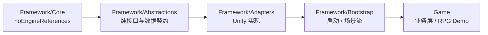

# MyFramework · Unity 游戏框架

> 分层 + DI + 模块化的 Unity 框架 —— 新做一个游戏 demo 只需要**加文件**，不需要改框架或启动代码。

| 项 | 说明 |
|---|---|
| 引擎 | Unity 2022.3 LTS（URP / Addressables / Input System / TextMeshPro） |
| 分层 | `Core`（无引擎依赖）→ `Abstractions`（纯接口）→ `Adapters`（Unity 实现）→ `Bootstrap`（启动/场景流）→ `Game`（业务） |
| 扩展方式 | 反射自动发现 `IServiceModule` / `IConfigFactory` / `ILoadStepProvider` / `BootstrapRunner`，**新增功能零改框架代码** |
| 质量 | 编译零警告；**167 例 EditMode + 10 例 PlayMode** 自动化测试全绿；启动/切场景控制台无异常无警告 |

---

## 📚 文档索引

| 文档 | 内容 |
|---|---|
| **`README.md`（本文）** | 5 分钟接入指南 + 项目概览与进度 |
| [`PROJECT_GUIDE.md`](./PROJECT_GUIDE.md) | 完整工程文档：架构、文件地图、问题清单、命名约定、接入成本实测 |
| [`SCENE_CONFIG_DESIGN.md`](./SCENE_CONFIG_DESIGN.md) | 场景配置化设计稿与实施记录 |
| [`UI_POPUP_DESIGN.md`](./UI_POPUP_DESIGN.md) | UI 弹窗系统设计稿（全局栈 / 模态 / 串行队列 / 超时） |
| [`INPUT_DESIGN.md`](./INPUT_DESIGN.md) | 输入服务设计与实测记录 |
| [`RPG_DEMO_DESIGN.md`](./RPG_DEMO_DESIGN.md) | 3D RPG Demo 需求规格 + 详细设计 + 分阶段计划与进度 |
| [`docs/STARTUP_LOG.md`](./docs/STARTUP_LOG.md) | 启动自检：预期日志与判据 |
| [`docs/FONTS.md`](./docs/FONTS.md) | 中文字体需自备（本仓库不含商业字体） |
| [`docs/PITFALLS.md`](./docs/PITFALLS.md) | 实战踩坑清单（29 条，按主题分类） |

---

## ✨ 特性

- **零改框架扩展**：新增服务 / 配置 / 加载步骤 / UI 面板 / 场景，只需**加文件** —— 框架反射发现并自动接线。
- **自研轻量 DI 容器**：构造函数注入、单例/工厂注册、递归解析、循环依赖检测与明确报错；`ServiceLocator` 提供静态入口。
- **模块化**：`IGlobalServiceModule` + `ISceneServiceModule`；每个场景一个**独立子容器**，场景卸载即释放其中的 `IDisposable` 服务。
- **零挂载启动**：`FrameworkStartEntry` 在 `BeforeSceneLoad` 自动建常驻根节点，按「模块扫描 → 日志 → 加载管线 → SceneFlow → 入口场景」装配，业务不用写启动代码。
- **统一加载管线**：启动阶段与「进入场景前的预加载」共用同一套 `ILoadStep` / `ILoadContext`（可上报进度、单步异常不中断管线）。
- **配置驱动的 UI 系统**：分层 Canvas（Background…Overlay）+ 层内 `priority` 排序、面板缓存、场景标签、异步打开；**弹窗栈**支持模态遮罩、优先级、串行队列与超时取消；**UI 打开自动阻断玩法输入**（输入上下文，无需手写代码）。
- **配置驱动的场景流**：`SceneCatalog` 描述场景（加载地址 / 是否常驻 / 专属预加载 / 标签），**4 种切换策略**（`SingleDirect` / `ThroughLoadingScene` / `Additive` / `AdditiveUnloadFirst`）一个旋钮切换；过渡期自动静音旧场景 `AudioListener`、关闭旧场景灯光，避免「双监听器 / 瞬间偏亮」。
- **基础服务齐全**：日志、事件总线、资源（Addressables）、存储、配置、场景、UI、输入、音频（总线音量 / 淡入淡出 / Duck / 池化）。
- **输入服务**：上下文栈（UI 阻断玩法）、动作查询与事件、可替换后端（Input System / Null / Mock），框架**不含任何操作语义**。
- **编辑器生产力工具**：场景配置一键同步与校验、场景名下拉、RPG 场景装配器、程序化光标图标生成。
- **质量基线**：编译零警告；167 例 EditMode + 10 例 PlayMode 自动化测试；业务层零 Addressables 依赖。

---

## 📈 项目进度

### 框架

| 里程碑 | 状态 | 说明 |
|---|---|---|
| M1 最小可运行 | ✅ | 启动链路端到端跑通、`SwitchScene` 可用 |
| M2 UI 链路 | ✅ | 配置驱动注册 → 异步加载 → 开关/缓存/分层 + Loading 面板 |
| M3 框架达标 | ✅ | 模块化 / 分层收口 / 命名规范 / 质量基线 |
| M4 Demo 验证 | ✅ | 新增面板 4 步接入**零改框架**实测 |
| P0–P9 收尾打磨 | ✅ | 弹窗系统、输入服务、场景配置化、切换策略收敛、音频服务、测试补齐 |

「完成」的定义（DoD D1–D8：启动全通 / 基础服务齐全 / UI 全链路 / 场景流 / 模块化 / 分层干净 / 质量 / 文档）**已全部达成**，详见 [`PROJECT_GUIDE.md`](./PROJECT_GUIDE.md) §1.5。

### 示例游戏 · 3D RPG Demo

| 阶段 | 状态 |
|---|---|
| D 音频服务（框架级新增） | ✅ 完成 |
| A1 输入重绑 | ✅ 完成 |
| A2 Layer + `RPGScene` 关卡（NavMesh 烘焙） | ✅ 完成 |
| A3 Cinemachine 环绕相机（A/D + 滚轮缩放） | ✅ 完成 |
| A4 点击移动（`PlayerMotor` + 落点标记） | ✅ 完成 |
| A5 交互系统（拾取 / 对话 / 攻击 + 场景装配工具） | ✅ 完成 |
| A6 软件光标（6 状态，策略模式） | ✅ 完成 |
| A7 HUD 交互按钮 | ⬜ 待做 |
| I 物品·容器·装备 / B 战斗 / S 存档 / C 任务·对话 | ⬜ 未开始 |

> 完整需求、设计与阶段 DoD 见 [`RPG_DEMO_DESIGN.md`](./RPG_DEMO_DESIGN.md)（进度对照见其 §18）。

### 质量基线

- 编译**零警告**；启动 / 切场景 / 交互链路控制台**零错误零警告**。
- **167 例 EditMode**（`Assets/Scripts/Tests`）+ **10 例 PlayMode**（`Tests.PlayMode`，含只能在 Play 复现的输入后端回归）。
- 依赖方向单向不可逆；业务层不直接依赖 Addressables。

---

## 🚀 快速开始（3 步）

1. 用 Unity **2022.3** 打开本工程；
2. 打开 `Assets/Scenes/SampleScene.unity`；
3. 按 **Play**（不用挂任何脚本 —— `FrameworkStartEntry` 会自动装配整个框架）。

**自检**：启动日志应以 `启动完成` 结尾，且控制台无异常/无警告 —— 预期日志与判据见 [`docs/STARTUP_LOG.md`](./docs/STARTUP_LOG.md)。

**⚠️ 中文字体需自备**：本仓库不含商业中文字体，克隆后 TMP 中文会提示 missing reference —— 处理方式见 [`docs/FONTS.md`](./docs/FONTS.md)。

**（可选）验证场景切换**：运行模式下用菜单 `Tools/我的工具/场景切换/…` 在 `SampleScene` ↔ `Level2` 之间双向切换，观察加载日志（`开始切换` → `切换完成`）。

---

## 1. 接入到自己的工程（≈5 分钟）

### 1.1 拷贝框架程序集

把 `Assets/Scripts/Framework/` 整个目录拷到你的工程（含 `Core` / `Abstractions` / `Adapters` / `Bootstrap` 四个 asmdef）。

### 1.2 引导流程：框架已内置，业务不用写

拷贝框架后**什么都不用做**就能跑：`Framework/Bootstrap/FrameworkStartEntry` 会在游戏启动前
（`RuntimeInitializeOnLoadMethod(BeforeSceneLoad)`）自动创建常驻根节点 `[GameFramework]`，
交由 `GameRoot` → `BootstrapRunner`（框架通用引导流程）完成装配：

```text
模块扫描注册 → 日志门面 → 启动加载管线（预热配置 → 加载配置 → 业务步骤）
→ 创建/装配 SceneFlow → 常驻 Loading 场景 → 进入口场景 → 启动完成
```

需要定制时按需选**一种**（都不需要改框架代码）：

| 想改什么 | 怎么做 |
|---|---|
| 入口场景 / 常驻 Loading 场景名 | 实现 `IBootstrapOptionsProvider`（示例 `Game/Bootstrap/GameBootstrapOptions.cs`） |
| 启动阶段额外加载内容 | 实现 `IStartupLoadStepProvider`（示例 `Game/Bootstrap/UIPanelSetupStep.cs`） |
| 进入场景前预加载内容 | 实现 `ISceneLoadStepProvider` |
| 想改引导流程本身 | 继承 `BootstrapRunner` 并覆写钩子（`CreateOptions` / `CollectStartupSteps` / `CreateHooks` / `OnStartupCompleted` / `OnStartupProgress`）；框架会**自动发现**它（最多只能有一个实现） |

> `GameRoot.CreateRunner()` 会反射查找业务自定义的 `IBootstrapRunner`，找不到就用框架默认实现。
> 入口场景名留空时，默认取 **Build Settings 的第一个场景**。

### 1.3 程序集与扫描规则（重要）

| 规则 | 说明 |
|---|---|
| 程序集名前缀 | 只有以 `Abstractions` / `Adapters` / `Bootstrap` / `Game` / `Assembly-CSharp` **开头**的程序集会被扫描 |
| 跳过 | 名字含 `-Editor` 的程序集（如 `Game-Editor`） |
| 约束 | 模块类 / `IConfigFactory` 类需要**公开无参构造函数** |
| 顺序 | 按 `Order` 升序注册；`Order` 相同则按扫描顺序（后注册覆盖先注册） |

> 业务代码建议直接放 `Assembly-CSharp`，或自己建一个 `Game` 程序集。若你的程序集名不满足上述前缀，可在启动时显式传前缀：`ServiceModuleRegistry.Scan(new[] { "MyGame" })`。

---

## 2. 四条日常接入路径（都不改框架）

### 2.1 新增一个服务（2 个类）

```csharp
public interface IAnalytics { void Track(string evt); }

internal sealed class Analytics : IAnalytics
{
    private readonly ILogger _logger;
    public Analytics(ILogger logger) => _logger = logger;   // 构造函数注入，自动解析
    public void Track(string evt) => _logger.Info($"[Analytics] {evt}");
}

public sealed class AnalyticsModule : IGlobalServiceModule
{
    public int Order => 100;   // 框架核心模块是 -1000；更大的值可用于覆盖默认实现
    public void RegisterGlobal(IServiceRegistry registry)
        => registry.Register<IAnalytics, Analytics>();
}
```

放到 `Game` 程序集 → 启动时自动注册。取用：

```csharp
var analytics = ServiceLocator.Get<IAnalytics>();        // 静态上下文
var analytics = resolver.Resolve<IAnalytics>();          // 已持有 resolver
resolver.TryResolve<IAnalytics>(out var a);               // 不想抛异常时
```

### 2.2 新增一个场景级服务（每个场景各一份）

```csharp
public sealed class LevelModule : ISceneServiceModule
{
    public int Order => 100;
    public void RegisterScene(IServiceRegistry registry, string sceneName)
        => registry.Register<ILevelContext>(new LevelContext(sceneName));
}
```

每个场景会建一个独立子容器；**场景卸载时容器被 `Dispose`**（其中的 `IDisposable` 服务会被释放）。

### 2.3 新增一个 UI 面板（4 步）

**① 脚本**（继承 `UIPanelBase` + `[UIPanel("key")]`）：

```csharp
[UIPanel("ShopPanel")]
public sealed class ShopPanel : UIPanelBase
{
    protected override void OnCreate(IEventBus bus, ILogger logger)
    {
        base.OnCreate(bus, logger);
        Subscribe<GoldChangedEvent>(e => UpdateGold(e.Value));   // 面板销毁时自动退订
    }

    protected override void OnShow() { /* 打开时刷新 */ }
    protected override void OnHide() { /* 关闭时收尾 */ }

    private void UpdateGold(int value) { /* ... */ }
}
```

**② 做预制体**：把脚本挂到预制体根上即可（**不需要自带 Canvas** —— 层级 Canvas 由框架运行时创建）。

**③ 加入 Addressables**：`Assets/Prefabs/UI/ShopPanel.prefab` → 加入组 `Default Local Group`，并把地址改成短地址 `UI/ShopPanel`（地址栏默认填的是资产路径，建议手工改短；**这个地址就是下面 `PrefabAddress` 要填的值**）。

**④ 在 `UIConfigAsset.asset` 的 `panels` 里加一条 `UIPanelConfigSO`**：

| 字段 | 示例 | 说明 |
|---|---|---|
| `panelKey` | `ShopPanel` | 必须与 `[UIPanel("...")]` 一致 |
| `PrefabAddress` | `UI/ShopPanel` | Addressables 地址 |
| `Layer` | `Popup` | 决定挂到哪层 Canvas（见下表） |
| `cacheOnClose` | `true` | 关闭时只隐藏、不销毁 |
| `sceneTags` | `[SampleScene]` | 属于哪些场景。**留空 = 所有场景通用（跨场景常驻）** |
| `loadPolicy` | — | 加载策略 |
| `priority` | `0` | 层内优先级（越大越靠上，只在同 `Layer` 内生效） |
| `isModal` | `false` | 是否模态（弹窗栈会挡住其下层的点击；Toast 不要勾） |

打开面板：

```csharp
await ServiceLocator.Get<IUIService>().OpenAsync<ShopPanel>();
```

**层级与 `sortingOrder`**（`UIRootCreator` 自动创建，`UILayerOrder` 定义）：

| 层 | Canvas 名 | 层 Canvas order | 面板 order |
|---|---|---|---|
| `Background` | `Canvas_Background` | 1000 | 1001 起 |
| `Normal` | `Canvas_Normal` | 2000 | 2001 起 |
| `HighFrequency` | `Canvas_HighFrequency` | 3000 | 3001 起 |
| `Popup` | `Canvas_Popup` | 4000 | 4001 起 |
| `Toast` | `Canvas_Toast` | 5000 | 5001 起 |
| `Overlay` | `Canvas_Overlay` | 6000 | 6001 起 |

面板 order = `层基址 + 1 + Clamp(priority)`（严格高于自己层的 Canvas）。场景相机/Canvas 默认在 0，所以 UI 永远在他们之上。
同 order 时靠**打开顺序**决定（后开的在上）。

**分辨率**由 `UIConfigAsset` 的 `referenceResolution` / `matchWidthOrHeight` 驱动（写入 `UISettings`），不用改代码。

**场景预加载**：给面板填 `loadPolicy = Preload` + `sceneTags` 包含目标场景（**不能留空** —— 留空 = 全局常驻，不会按场景预加载），
框架会在**进入该场景前**把它预加载到内存（隐藏态），进场景后 `Open<T>()` 即为瞬开。
日志形如：`[Load] 预加载面板：1 个（ShopPanel）`。

### 2.4 新增一个配置（0 行改动）

```csharp
// ① 配置本体（纯代码配置，不需要任何资产）
public sealed class DemoTuningConfig : GameConfigBase
{
    public DemoTuningConfig() : base("DemoTuning", loadOrder: 0) { }
    public int StartGold { get; private set; } = 100;
    public override void Load(IAssetService assetService) => IsLoaded = true;
}

// ② 工厂（被自动发现，无需在任何地方登记）
public sealed class DemoTuningConfigFactory : IConfigFactory
{
    public IGameConfig CreateConfig() => new DemoTuningConfig();
}
```

- 若配置需要读取 **ScriptableObject 资产**：用 `ConfigBySO<TMyConfigSO>("Assets/.../MyConfig.asset")`，并把资产加入 Addressables；
- 启动时会打印 `[Config] 发现配置 N 个：...`；
- 读取：`configService.Get<DemoTuningConfig>().StartGold` 或 `configService.TryGet<DemoTuningConfig>(out var cfg)`；
- `loadOrder` 决定 `LoadAll` 的顺序（升序）。

### 2.5 新增一个加载步骤（启动 / 场景预加载）

启动与「进入场景前的预加载」**共用同一套加载步骤模型**：

```csharp
// 一个步骤 = 一段可组合的异步加载逻辑（可上报进度）
public sealed class LoadRemoteTableStep : ILoadStep
{
    public string Name => "拉取远程配置表";

    public IEnumerator Run(ILoadContext ctx)
    {
        var assets = ctx.Services.Resolve<IAssetService>();
        var task = assets.LoadAsync<TextAsset>("remote/table.json");
        while (!task.IsCompleted) { ctx.Report(Name, 0.5f); yield return null; }
        // …解析、写入 IStorage / 注册配置…
        ctx.Report(Name, 1f);
    }
}

// 注册步骤：启动阶段 与/或 场景预加载阶段（放在被扫描的程序集即可，自动发现）
public sealed class RemoteTableSteps : IStartupLoadStepProvider, ISceneLoadStepProvider
{
    public void Collect(IList<ILoadStep> steps, ILoadContext ctx)
    {
        steps.Add(new LoadRemoteTableStep());

        // 场景专属资源已由配置驱动（SceneCatalog.asset 的 preloadAddresses），不用写在这。
        // 这里只放「配置表达不了」的步骤，例如按场景预热某个业务分类：
        if (ctx.SceneName == "Level2")
            steps.Add(new PreloadAddressesStep("Level2 BGM", new[] { "Audio/Boss_BGM" }));
    }
}
```

要点：

- **加类即接入**，不用改 `BootstrapRunner` / `SceneFlow`；
- 需要精确顺序时，在**同一个** provider 里依次 `steps.Add`；
- 默认管线：启动 = `预热配置 → 加载配置 → 业务步骤`；场景 = `按 loadPolicy 预加载面板 → 按场景配置预加载专属资源 → 业务步骤`；
- **场景专属资源优先用配置**（`SceneCatalog.asset` 的 `preloadAddresses`，见 2.9）—— provider 只留给配置表达不了的场景；
- 要彻底改流程，继承 `BootstrapRunner` 覆写 `CollectStartupSteps`；
- 单个步骤抛异常只记日志，**不会中断整条管线**。

### 2.6 切换场景

```csharp
ServiceLocator.Get<ISceneFlow>().SwitchScene("Level2");
```

- 目标场景**必须加入 Build Settings**（用 Addressables 版服务时还需标记为 Addressable、地址=场景名，见 2.7）；
- 若目标场景已在内存中（例如编辑器已打开它），框架会**复用现有实例**而不会重复 Additive 加载（避免出现两套相机 / AudioListener）；
- 切换进度刻度：进入 **5%→30%** 跑场景预加载（见 2.5），**30%→90%** 等场景激活，**90%→100%** 收尾；
- 不需要 Loading 场景时，`BootstrapOptions.LoadingSceneName` 传 `null`；
- ⚠️ **必须在启动完成后再调用**：启动未完成时调用会被拒绝并告警（否则会与启动流程并发跑两条切换协程）；
- 切换期间新旧场景共存，框架会在旧场景卸载前**自动静音其 `AudioListener`**、并**关闭其灯光**（否则两套主光叠加会“瞬间偏亮”），避免切换出戏；
- 本工程内置演示：`SampleScene` ↔ `Level2`（运行模式下菜单 `Tools/我的工具/场景切换/...` 即可验证，两侧各自有专属预加载）。

**场景生命周期钩子**（可选）：实现 `ISceneFlowHooks`：

```csharp
RegisterSceneServices(container, sceneName)                     // 建场景容器时（默认转发给场景模块注册）
SceneResourcePreload(resolver, sceneName, report)               // 切换进度 5%→30%；report(0..1) 上报局部进度
SceneResourceRelease(resolver, leavingScene, enteringScene)     // 旧场景卸载后（默认清理「不属于新场景」的面板）
OnLoadingBegin / OnLoadingProgress(同步) / OnLoadingEnd          // Loading 遮罩显隐与进度
```

> ⚠️ `SceneResourceRelease` 有 **两个** 场景参数：`leavingScene` 与 `enteringScene`。
> 清理的判据是「**不属于新场景**」（例如为进入场景预加载好的面板必须保留），
> 只看离开的场景会把刚预加载的东西误删。
>
> 默认实现 `DefaultSceneFlowHooks` 已经做了：Loading 面板显隐、场景模块注册、场景预加载、按场景归属清理面板。
> 通常**不需要**自己写钩子；只想加预加载内容的话用 2.5 的 `ISceneLoadStepProvider`。

---

### 2.7 切换场景加载方式（Build Settings ↔ Addressables）

框架默认用 `UnitySceneService`（按 **Build Settings** 加载）。若场景需要**远端打包 / 热更**，可换成 `AddressablesSceneService`（按**地址**加载，地址默认 = 场景名）—— 只需一个模块覆盖默认实现：

```csharp
public sealed class GameSceneServiceModule : IGlobalServiceModule
{
    public int Order => 0;   // 大于框架核心模块(-1000) → 后注册者覆盖
    public void RegisterGlobal(IServiceRegistry registry)
        => registry.Register<ISceneService, AddressablesSceneService>();
}
```

- 示例见 `Game/Modules/GameSceneServiceModule.cs`（**本工程已启用**）；删除该类即回退到 Build Settings 方式；
- 前提：场景资产已标记为 Addressable，且**地址与场景名一致**（本工程的 `SampleScene` / `LoadingScene` 即如此）；
- 日志可确认走的是哪条路：`[Scene] Addressables 加载：SampleScene（Additive，activateOnLoad=false）`。

---

### 2.8 让面板只在某些场景可用（面板场景标签）

面板配置里的 `sceneTags` 一行决定三件事，**留空则是全局常驻**：

| 配置 | 打开校验 | 进场景前预加载 | 离开场景时销毁 |
|---|---|---|---|
| `sceneTags` 为空 | 任何场景都可开 | 不预加载（视为全局） | **不销毁**（跨场景常驻） |
| `sceneTags = [SampleScene]` | 仅 `SampleScene` 可开，其他场景**拒绍并告警** | 进入 `SampleScene` 前预加载 | 进入其他场景时销毁 |

```csharp
// 启动步骤里可关掉「强制拦截」，改成只告警（默认 true = 拦截）
services.Register(new UISettings { EnforceSceneTags = false });
```

> **弹窗栈**（`IPopupService`）的相关开关也在 `UISettings` 上：`PopupQueueTimeoutSeconds`
> —— `PushAsync` 队列中「单项打开」的超时（默认 10s，`<=0` 关闭），避免一次卡住的加载堵死整条队列。
> 取消是隐式的：`Pop` / `PopAll` / 场景切换会作废所有待处理项（被取消的项不显示、不入栈，以 `null` 完成）。

同一个 `sceneTags` 还会和 `loadPolicy` 配合，决定**进入场景前要不要预加载**那个面板：

```text
loadPolicy = Preload + sceneTags 非空且包含目标场景  →  进场景前预实例化并隐藏
```

> 小贴士：**预加载筛选看的是「目标场景」**（切换中 ActiveScene 还是旧场景），
> 而**打开时的校验看的是「当前活动场景」** —— 两者职责不同，框架分别处理。

---

### 2.9 把场景做成配置（与 UI 对称）

场景也可以像 UI 面板一样「只改配置、不改代码」：

```text
SceneCatalog.asset（总表：入口场景 / Loading 场景 / 切换策略 / 登记方式）
  └─ SceneConfigSO（单项：场景名 / 地址 / 加载模式 / 常驻 / 是否显示 Loading
                     / 专属预加载地址 / 标签 / 容器等待超时）
```

新增一个场景只需四步：

1. 建场景，在 `SceneCatalog.asset` 里加一条 `SceneConfigSO`（`sceneName` 有**下拉**可直接选）；
2. 点检视面板的 **「同步场景登记」** 按钮 → 自动写进 Addressables（或 Build Settings）；
3. 要专属预加载 → 直接在配置里填 `preloadAddresses`（**不用写代码**）；
4. 要专属面板 → 面板配置的 `sceneTags` 填该场景名。

运行期查询：

```csharp
var def = ServiceLocator.Get<ISceneFlow>().GetDefinition("Level2");
if (def != null && def.HasTag("level")) { /* ... */ }
```

要点：

- **零配置也能跑**：没建配置时，任何场景回退为「Additive / 不常驻 / 显示 Loading」，行为与以前完全一致；
- 启动期会校验配置并告警（入口未登记 / 重复场景名 / 地址缺失…），详见 `SCENE_CONFIG_DESIGN.md`；
- **`transitionPolicy`（全局，**一个旋钮**）**：把原来的「每条场景的 `loadMode`」与「全局 `swapPolicy`」**合并成一个枚举**，统一回答一个问题：**旧场景何时释放**；
- ⚠️ `Single*` 策略**不支持 `persistent` 场景**（引擎会摧毁它们）；框架检测到这种组合会**告警并自动改用 `Additive`**（不静默做错事）。

### 2.10 切场景的两种加载模式 / 两种时序（选读）

| `transitionPolicy` | 效果 | 内存峰值 | 共存窗口 |
|---|---|---|---|
| `SingleDirect`（**默认**） | 直接以 Single 加载目标（旧场景到目标就绪才关闭） | 旧 + 新 | 无 |
| `ThroughLoadingScene` | **A → Loading 场景 → B**（先 Single 加载 Loading 关旧，再 Single 加载目标） | **最低** | 无 |
| `Additive` | 以 Additive 加载目标，激活后卸旧 | 旧 + 新 | **有**（框架自动静音旧监听器/关旧灯光） |
| `AdditiveUnloadFirst` | 先卸旧，再以 Additive 加载目标 | 最低 | 无 |

- `Single*` 是**推荐模型**（无共存窗口 → 不需要音频/灯光补丁）；`Additive*` 是**逃生舱**（只有它们支持常驻场景 / 子场景 / 交叉淡化）。
- ⚠️ `ThroughLoadingScene` 与 `AdditiveUnloadFirst` 依赖「旧场景释放后的独立画面」，需要配 `loadingSceneName` 且该场景**自带相机**；缺失时框架会告警（后者还会**回退为 `Additive`**）。

判据（日志）：切换完成那行会列出当前已加载的场景，例如
`切换完成：Level2（已加载场景：LoadingScene、Level2）`。

### 2.11 新增一个输入动作（改 2 处，框架零改动）

框架只提供**输入基础设施**（生命周期 / 上下文栈 / 查询 / 后端适配），**不含任何操作语义**（框架里没有 `Jump`/`Attack`）。

1. **绑定资源**：在 `Assets/Scripts/Game/Inputs/GameInputActions.inputactions` 里给对应 ActionMap 加一个 Action
   （与本项目一样把资产**标记为 Addressable**；地址见 `AttachInputActionsStep.Address`）。
2. **加常量**：在 `Game.Inputs.GameActions` 里加 `public const string Xxx = "Xxx";`。

读输入（玩法只依赖接口，**不要**直接读 `InputAction` / `Input.GetButton`）：

```csharp
var input = ServiceLocator.Get<IInputService>();
if (input.WasPressedThisFrame(GameActions.Jump)) Jump();
var move = input.GetVector2(GameActions.Move);
input.ActionTriggered += e => Debug.Log($"{e.ActionId} {e.Phase} {e.Scalar}");   // 事件为辅
```

**上下文（UI 阻断玩法就是这个）**：有效上下文 = 优先级最高的那一批。

```csharp
input.PushContext(GameActions.Contexts.Gameplay, GameActions.Priorities.Gameplay);  // 进玩法
input.PushContext(GameActions.Contexts.UI, GameActions.Priorities.UI);              // 开 UI → 玩法输入被阻断
input.PopContext(GameActions.Contexts.UI);                                          // 关 UI → 自动恢复
```

- 空栈 = **不限制**（不用上下文的项目行为不变）；同名重复 Push 会**计数**，需等次数 Pop。
- **UI 面板会自动阻断**：在面板配置里填 `inputContextId = UI`（本项目 `DemoPanel` 已填）→ 打开自动 Push、关闭/被场景销毁自动 Pop，玩法输入相应被阻断/恢复，**不用手写代码**。
- 换后端：再写一个 `IGlobalServiceModule`，`Order > 10`，`registry.Register<IInputBackend>(new XxxBackend())` 即可（后注册者覆盖）。
- 演示：见 `Game/RPG/` —— `InteractionDriver` 逐帧查询 `Click` / `Interact` 动作；UI 面板填 `inputContextId` 后打开自动阻断玩法输入。

完整设计、接口与实测记录见 [`INPUT_DESIGN.md`](./INPUT_DESIGN.md)。

## 3. 常用 API 速查

| 想做的事 | API |
|---|---|
| 取服务 | `ServiceLocator.Get<T>()`、`resolver.Resolve<T>()`、`resolver.TryResolve<T>(out T)` |
| 注册服务（模块内） | `registry.Register<TImpl>()`（单例，依赖自动注入）、`registry.Register(instance)`、`registry.RegisterFactory<T>(r => ...)` |
| 事件 | `IEventBus.Subscribe<T>(h)` / `Publish(evt)`；面板内用 `Subscribe<T>()`（自动回收） |
| UI | `IUIService.OpenAsync<T>()` / `Open<T>()` / `Close<T>()` / `CloseAll()` / `PreloadAsync<T>()` / `IsOpen<T>()` |
| 资源 | `IAssetService.Load<T>()`（同步）、`LoadAsync<T>()`（推荐）、`PreloadAsync()`、`ReleasePreloaded()` |
| 配置 | `IGameConfigService.Get<T>()` / `TryGet<T>(out T)` |
| 场景 | `ISceneFlow.SwitchScene(name)`、`CurrentSceneName`、`Current`（当前场景容器） |
| 存储 | `IStorage.Save<T>()` / `Load<T>()` / `Delete()` / `Clear(prefix)` |
| 日志 | 优先构造函数注入 `ILogger`；静态代码用 `Log.Info/Warn/Error`（需先 `Log.Init`） |
| 加载步骤 | `ILoadStep` / `ILoadContext`（`ctx.Services`、`ctx.SceneName`、`ctx.Report`）；提供者 `IStartupLoadStepProvider` / `ISceneLoadStepProvider` |
| 输入 | `IInputService.IsPressed/WasPressedThisFrame/GetAxis/GetVector2`、`PushContext/PopContext`、事件 `ActionTriggered` |
| 引导参数 | `IBootstrapOptionsProvider.CreateOptions()` → `EntrySceneName` / `LoadingSceneName` / `ScanPrefixes` |

> 命名冲突提醒：`Framework.Abstractions.Logging.ILogger` 与 `UnityEngine.ILogger` 同名，请用
> `using ILogger = Framework.Abstractions.Logging.ILogger;`

---

## 4. 目录与分层



```text
Assets/Scripts/
├── Framework/
│   ├── Core/           # 无引擎依赖内核：DI 容器 / 服务定位 / 描述符
│   ├── Abstractions/   # 纯接口与数据契约
│   │   ├── Assets/ Audio/ Events/ GameConfig/ Input/ Loading/
│   │   │   Logging/ Modules/ Scenes/ Storage/ UI/
│   │   └── Loading/    # ILoadStep / ILoadContext / ILoadStepProvider / LoadPipeline + 内置步骤
│   ├── Adapters/       # Unity 实现（Addressables / 场景 / 存储 / UI / 日志 / 输入 / 音频）+ CoreServiceModule
│   └── Bootstrap/      # FrameworkStartEntry / GameRoot / BootstrapRunner / SceneFlow
│                       # + 自动发现：ServiceModuleRegistry / GameConfigRegistry / LoadStepCollector
├── Game/               # 业务层（框架示例 + RPG demo）
│   ├── Bootstrap/      # 引导参数 + 启动步骤（应用 UI 配置 / 场景目录→ISceneCatalog）
│   ├── Scenes/Config/  # 场景配置（SceneConfigSO / SceneConfigAssetSO / Factory / Validation）
│   ├── Editor/         # 编辑器工具（Game-Editor）：同步登记 + 场景下拉 + 校验 + 光标图标生成
│   ├── Modules/        # 示例模块：全局/场景服务、切换场景服务为 Addressables 版
│   ├── Inputs/         # 输入：GameActions / GameInputModule / inputactions 资产 / 接入步骤
│   ├── Config/         # 示例：纯代码配置 + IConfigFactory
│   ├── UI/             # 面板（LoadingPanel / DemoPanel）+ UIConfigAsset
│   └── RPG/            # RPG Demo：Cameras / Players / Interaction / Cursors / Data
├── Fonts/              # 中文字体（⚠️ 本地自备、不入库，见 docs/FONTS.md）
├── UI/Tools/           # LoadingDots / ProgressBar 小工具（命名空间 Game.UI.Tools）
└── Tests/              # EditMode 测试（167 例）
    └── PlayMode/       # PlayMode 测试（10 例，程序集 Tests.PlayMode）
```

**依赖方向（不可逆）**：`Core` ← `Abstractions` ← `Adapters` ← `Bootstrap` ← `Game`。
`Core` 是 `noEngineReferences` 的，业务层不直接依赖 Addressables。

---

## 5. 实战踩坑清单

> 29 条实战经验已拆分到 **[`docs/PITFALLS.md`](./docs/PITFALLS.md)**（按主题分类：场景与切换 / UI 与面板 / 资源与配置 / 程序集与模块化 / 输入服务 / 自动化验证）。

---

## 6. 更多

- **跑测试**：Test Runner → **EditMode 167 例** + **PlayMode 10 例**（`Tests.PlayMode` 用合成手柄 + `ProcessEventsManually` 注入真实输入，覆盖那个只能在 Play 复现的 `activeValueType` bug）。
- **接入成本实测**：见 `PROJECT_GUIDE.md` §12（新增服务 / 面板 / 配置三条路径的实测记录）。
- **文档索引**：见文首 [📚 文档索引](#-文档索引)。

